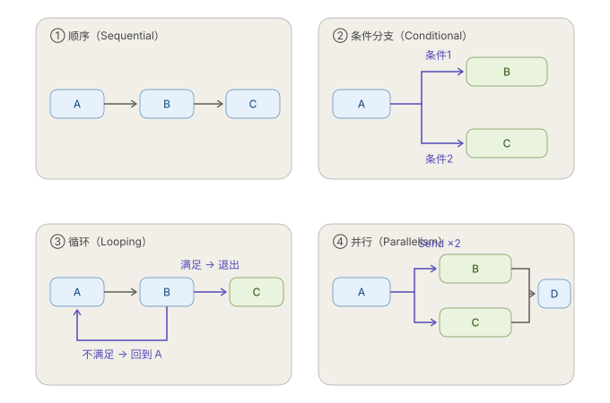
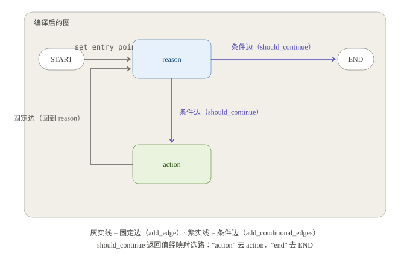
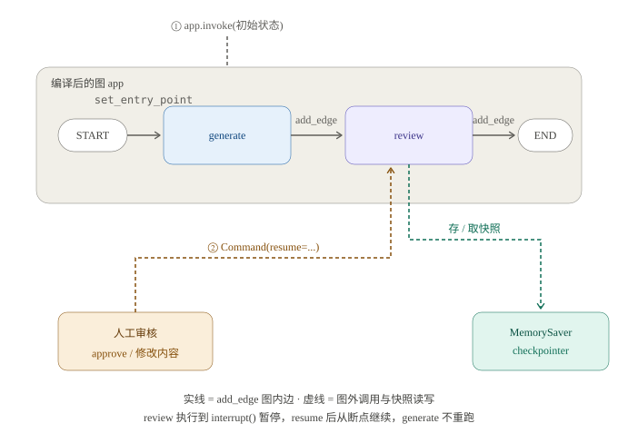
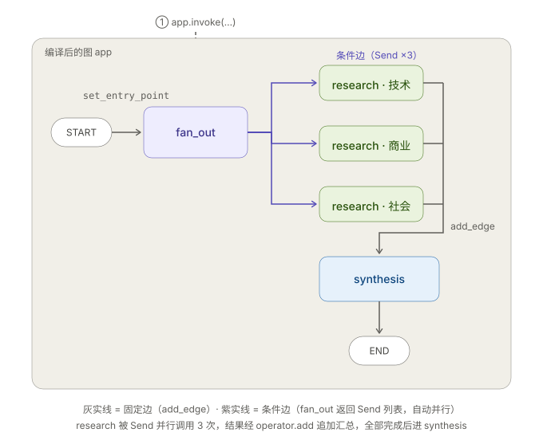

## 一、结论前置

1. **Agentic Workflow（智能体工作流编排）是用“有向图”来建模和执行 Agent 工作流的范式——节点是处理步骤（LLM 调用、工具执行、人工审核），边是控制流（顺序、条件分支、循环、并行），状态是在所有节点之间流动和持久化的共享数据**。与传统工作流（如 Airflow 的静态 DAG）不同，Agentic Workflow 支持循环（ReAct 的“思考-行动-观察”循环）、动态决策（根据运行时状态选择不同路径）、人机交互（暂停等待人工审批）和长时间运行（跨天/跨会话的工作流）。代表框架是 LangGraph（2025年10月发布 1.0）。
2. **Agentic Workflow 的四大核心能力**：①**有状态执行**（State）——所有节点共享一个类型化的状态对象，节点读取状态、更新状态，状态在节点之间流动；②**持久化与恢复**（Checkpointing）——每个节点执行后自动保存状态快照，崩溃后从断点恢复，支持多日审批流程和跨会话工作流；③**人机交互**（Human-in-the-loop）——可以在任意节点暂停，等待人工审核/修改/批准，然后从断点恢复；④**灵活控制流**——支持顺序、条件分支、循环、并行，能表达 ReAct 循环、Plan-and-Execute、Supervisor 等复杂架构。
3. **Agentic Workflow 不是“更复杂的 Pipeline”，而是本质不同的范式**。Pipeline 是静态的、线性的、无环的——顺序固定，不能循环，不能动态决策。Agentic Workflow 是动态的、图状的、有环的——可以根据运行时状态决定下一步，可以反复循环直到满足条件，可以暂停等待人工。传统工作流引擎（Airflow、Prefect）的 DAG 模型无法表达 Agent 的循环推理（ReAct loop），这就是为什么需要专门的 Agentic Workflow 编排框架（如 LangGraph）。

---

## 二、通俗类比 + 专业定义

### 通俗类比

#### Agentic Workflow = 电子游戏的“任务系统 + 存档系统”

- **任务图（有向图）**：
  - 游戏中的任务不是线性的，而是一个任务图——有些任务必须按顺序做（“先拿到钥匙才能开门”），有些任务可以选择不同路径（“可以走正门也可以走密道”），有些任务需要反复做（“打 Boss 失败了要重新打”），有些任务可以同时做（“同时收集三个道具”）
  - Agentic Workflow 就是这样的任务图——节点是任务步骤，边是任务之间的依赖和选择

- **状态（State）**：
  - 游戏中的角色有状态（生命值、等级、背包、任务进度），所有任务都读取和更新这个状态
  - Agentic Workflow 中的状态就是“Agent 的当前情况”——用户输入、中间结果、工具输出、任务进度，所有节点都读写这个状态

- **存档（Checkpoint）**：
  - 游戏可以随时存档，下次读档继续玩——即使游戏崩溃了、电脑关机了，存档还在，读档就能从上次的位置继续
  - Agentic Workflow 的 Checkpoint 就是“存档”——每个步骤执行后自动存档，工作流崩溃了、服务器重启了、过了几天再回来，都能从存档点继续

- **暂停等玩家（Human-in-the-loop）**：
  - 游戏中有些关键决策会暂停，等玩家选择（“你确定要杀死这个 Boss 吗？”“你要选择哪个结局？”）
  - Agentic Workflow 可以在关键步骤暂停，等人工审核/批准（“这个代码修改你批准吗？”“这个邮件你确认发送吗？”），人工确认后继续

#### 为什么这种模式有效？
- 任务图比线性流程更灵活——能表达选择、循环、并行，适合复杂的 Agent 任务
- 状态共享让所有步骤有一致的上下文——不会“前面做了什么后面不知道”
- 存档让长时间运行的工作流成为可能——Agent 可以工作几小时、几天，中间可以中断和恢复
- 人机交互让高风险决策有人类把关——Agent 可以做大部分工作，但关键决策由人确认

### 专业定义

| 概念                           | 定义                                                                                                                                  |
| ---------------------------- | ----------------------------------------------------------------------------------------------------------------------------------- |
| **Agentic Workflow（智能体工作流）** | 用有向图建模和执行 Agent 工作流的范式。节点是处理步骤（LLM 调用、工具执行、人工审核等），边是控制流（顺序、条件分支、循环、并行），状态是在节点之间流动和持久化的共享数据。支持循环推理、动态决策、人机交互和长时间运行。                  |
| **StateGraph（状态图）**          | Agentic Workflow 的核心抽象——一个有向图，其中每个节点接收当前状态并返回状态更新，边定义节点之间的执行流（包括条件边和循环边）。状态是一个类型化的对象，在图的执行过程中持续更新和持久化。LangGraph 的核心抽象。              |
| **Node（节点）**                 | 图中的一个处理步骤，通常是一个 Python 函数，接收当前状态，执行处理（LLM 调用、工具执行、数据转换等），返回对状态的更新。节点可以是同步的也可以是异步的。                                                  |
| **Edge（边）**                  | 连接两个节点的有向边，定义执行流从一个节点到另一个节点。分为普通边（固定连接）和条件边（根据运行时状态动态决定下一个节点）。                                                                      |
| **Conditional Edge（条件边）**    | 根据当前状态动态决定下一个节点的边。条件边是一个函数，接收状态，返回下一个节点的名称。这是 Agent 动态决策能力的基础——如 ReAct 中“是否继续调用工具”的决策。                                              |
| **State（状态）**                | 在图的所有节点之间共享的数据对象，通常是一个类型化的字典（TypedDict）或 Pydantic 模型。状态包含 Agent 执行所需的所有信息——用户输入、中间结果、工具输出、消息历史、任务进度等。节点读取状态的部分字段，返回对部分字段的更新。        |
| **Checkpoint（检查点/存档）**       | 图在某个时间点的状态快照。每个节点执行后，框架自动将当前状态保存为 Checkpoint。Checkpoint 支持故障恢复（从最近的 Checkpoint 恢复）、时间旅行（回到任意历史 Checkpoint 重新执行）和人机交互（暂停后人工修改状态再恢复）。 |
| **Checkpointer（检查点存储器）**     | 持久化 Checkpoint 的后端存储。常见实现：MemorySaver（内存，开发用）、SqliteSaver（SQLite 数据库）、PostgresSaver（PostgreSQL 数据库，生产用）、RedisSaver（Redis，高并发用）。     |
| **Human-in-the-loop（人机交互）**  | 在工作流执行过程中暂停，等待人工介入（审核、修改、批准、补充信息），然后从断点恢复执行的模式。是高风险 Agent 应用的必备能力——Agent 做大部分工作，关键决策由人把关。                                           |
| **Interrupt（中断）**            | 在图的执行过程中主动暂停的机制。通过 `interrupt` 函数在节点中触发中断，工作流暂停并保存当前状态，等待外部输入（通常是人工操作），收到输入后用 `Command` 恢复执行。                                       |
| **Durable Execution（持久化执行）** | 工作流可以长时间运行（几小时、几天、几周），中间可以被中断（服务器重启、部署、人工等待），恢复后从断点继续，不会丢失任何进度。是生产级 Agent 工作流的核心要求。                                                 |

---

## 三、底层机制

### 一、Agentic Workflow 的核心架构

```
┌─────────────────────────────────────────────────────────────┐
│                      StateGraph（状态图）                      │
│                                                               │
│  ┌────────┐    ┌────────┐    ┌────────┐    ┌────────┐     │
│  │ Node A │───▶│ Node B │───▶│ Node C │───▶│ Node D │     │
│  │(LLM调用)│    │(工具执行)│    │(人工审核)│    │(结果生成)│     │
│  └────────┘    └────┬───┘    └────────┘    └────────┘     │
│                      │ 条件边                                  │
│                      ▼                                        │
│              ┌────────────┐                                   │
│              │  Node E     │  ◀── 循环边（回到 Node B）       │
│              │(错误处理/重试)│                                   │
│              └────────────┘                                   │
│                                                               │
│  状态（State）：在所有节点之间流动，每个节点读写状态            │
│  ┌─────────────────────────────────────────────────────┐    │
│  │  user_input: str                                      │    │
│  │  messages: list[BaseMessage]                          │    │
│  │  tool_results: dict                                   │    │
│  │  intermediate_data: any                               │    │
│  │  task_progress: str                                   │    │
│  └─────────────────────────────────────────────────────┘    │
└─────────────────────────────────────────────────────────────┘
                           │
                           ▼
┌─────────────────────────────────────────────────────────────┐
│                   Checkpointer（存档系统）                     │
│                                                               │
│  每个节点执行后自动保存状态快照：                               │
│  Checkpoint 1 (Node A 后) → Checkpoint 2 (Node B 后) → ... │
│                                                               │
│  支持：故障恢复 / 时间旅行 / 人机交互 / 跨会话                 │
└─────────────────────────────────────────────────────────────┘
```

### 二、状态（State）的工作机制

**状态是 Agentic Workflow 的“血液”——所有节点都通过状态交换信息。**

```python
from typing import TypedDict, Annotated
from langchain_core.messages import BaseMessage
import operator

# 定义状态类型（TypedDict）
class AgentState(TypedDict):
    # 用户输入
    user_input: str
    # 消息历史（用 operator.add 表示追加，而不是覆盖）
    messages: Annotated[list[BaseMessage], operator.add]
    # 工具调用结果
    tool_results: dict
    # 中间数据
    research_notes: str
    # 任务进度
    current_step: str
    # 重试计数
    retry_count: int
```

#### 节点如何读写状态

```python
def research_node(state: AgentState) -> dict:
    """研究节点：读取状态，执行研究，返回状态更新"""
    # 读取：从状态中获取需要的信息
    query = state["user_input"]

    # 执行：调用工具/LLM
    notes = search_and_summarize(query)

    # 返回：只返回需要更新的字段（不是完整状态）
    # 框架会自动合并到全局状态
    return {
        "research_notes": notes,
        "current_step": "research_done",
        "messages": [AIMessage(content=f"研究完成：{notes[:100]}...")]
        # messages 用了 operator.add，所以这里是追加，不是覆盖
    }
```

#### 关键设计原则

1. **节点只返回需要更新的字段**，不是完整状态——框架自动合并
2. **用 `Annotated[list, operator.add]` 表示追加字段**（如消息历史），而不是覆盖
3. **状态是类型化的**（TypedDict/Pydantic），减少运行时错误
4. **状态应该精简**，只包含必要信息——状态越大，Checkpoint 存储和恢复越慢

### 三、Checkpoint（存档）的工作机制

**Checkpoint 是 Agentic Workflow 的“存档系统”——让工作流可以中断和恢复。**

```
工作流执行时间线：
  Node A → [保存 Checkpoint 1] → Node B → [保存 Checkpoint 2] → Node C → [保存 Checkpoint 3] → ...

故障恢复：
  Node A → [Checkpoint 1] → Node B → [崩溃！]
                                    ↓
                              从 Checkpoint 1 恢复，重新执行 Node B

时间旅行：
  执行到 Node D 后，发现 Node B 的结果有问题
  → 回到 Checkpoint 2（Node B 后的状态）
  → 修改状态（修正 Node B 的结果）
  → 从 Checkpoint 2 重新执行 Node C、Node D

人机交互：
  Node A → [Checkpoint 1] → Node B → [interrupt：暂停，等人工审核]
                                                    ↓
                                              人工审核/修改状态
                                                    ↓
                                              从修改后的状态恢复，继续 Node C
```

#### Checkpointer 的实现层级

| Checkpointer | 存储后端 | 适用场景 | 持久化 |
| --- | --- | --- | --- |
| MemorySaver | 内存 | 开发/测试 | ❌ 进程重启后丢失 |
| SqliteSaver | SQLite 文件 | 小型应用/单用户 | ✅ 文件持久化 |
| PostgresSaver | PostgreSQL | 生产级/多用户 | ✅ 数据库持久化 |
| RedisSaver | Redis | 高并发/低延迟 | ✅ 可配置持久化 |

#### 为什么 Checkpoint 对生产级 Agent 至关重要

1. **故障容错**：Agent 工作流可能运行很长时间（几分钟到几小时），中间任何一步都可能失败（API 超时、网络中断、服务器重启）。没有 Checkpoint，失败后所有进度丢失，必须从头开始
2. **长时间运行**：很多 Agent 任务需要等待外部事件（人工审批、第三方回调、定时触发），可能需要几小时甚至几天。没有 Checkpoint，无法跨会话保持状态
3. **人机交互**：高风险决策需要人工审核，工作流必须能暂停、等人工、再恢复。没有 Checkpoint，无法实现这种“暂停-恢复”模式
4. **调试和回溯**：Agent 出错后，可以回到之前的 Checkpoint，检查当时的状态，找出问题原因。甚至可以“时间旅行”，修改状态后重新执行

### 四、Human-in-the-loop（人机交互）的工作机制

**Human-in-the-loop 是高风险 Agent 应用的必备能力——Agent 做大部分工作，关键决策由人把关。**

```python
from langgraph.types import interrupt, Command

def code_review_node(state: AgentState) -> dict:
    """代码审核节点：Agent 生成修改建议，然后等人工批准"""
    # Agent 生成代码修改建议
    suggested_changes = generate_code_changes(state["code"])

    # 中断：暂停工作流，等待人工输入
    # interrupt 的参数会被返回给调用方（展示给人工）
    human_decision = interrupt({
        "type": "approval",
        "message": "Agent 建议以下代码修改，请审核：",
        "changes": suggested_changes,
        "options": ["approve", "reject", "modify"]
    })

    # 人工决策后，工作流从这里恢复
    # human_decision 是人工输入的内容
    if human_decision["action"] == "approve":
        apply_changes(suggested_changes)
        return {"status": "changes_applied"}
    elif human_decision["action"] == "reject":
        return {"status": "changes_rejected"}
    else:  # modify
        apply_changes(human_decision["modified_changes"])
        return {"status": "changes_modified"}
```

#### 人机交互的常见模式

| 模式 | 说明 | 示例 |
| --- | --- | --- |
| **审批（Approval）** | Agent 提出动作，人工批准/拒绝后执行 | 发送邮件前确认、删除数据前确认 |
| **审核（Review）** | Agent 生成结果，人工审核/修改后使用 | 代码审核、文章审核、报告审核 |
| **补充信息（Clarification）** | Agent 遇到不确定，向人工提问后继续 | “这个需求我不确定，能补充一下吗？” |
| **纠错（Correction）** | Agent 出错后，人工指出错误，Agent 修正 | “你理解错了，应该是这样...” |
| **时间旅行（Time Travel）** | 人工回到之前的 Checkpoint，修改状态，重新执行 | 发现早期步骤错了，回去修正后重新跑 |

#### 关键数据点（Anthropic 遥测，约 100 万次工具调用）

来源：Anthropic 研究报告《Measuring AI agent autonomy in practice》（2026-02，见文末资料来源）。

- **73%** 的工具调用涉及某种形式的人机交互
- **只有 0.8%** 的动作是不可逆的
- 这说明：大多数 Agent 动作都需要人类某种形式的参与，完全自主的 Agent 是少数
- 注意：Anthropic 自己声明这是**上界**——分类由 Claude 自动生成，会高估人机参与比例；且样本只覆盖 Anthropic 一家 API 流量，不能直接外推到整个行业

### 五、灵活控制流：顺序、分支、循环、并行

**Agentic Workflow 能表达四种基本控制流，组合起来可以实现任意复杂的 Agent 架构。**

#### 1. 顺序（Sequential）
```
Node A → Node B → Node C → Node D
```
- 最简单的控制流，和 Pipeline 一样
- 适用：步骤固定、有严格先后依赖的任务

#### 2. 条件分支（Conditional Branching）
```
Node A → [条件判断]
              ├─ 条件1 → Node B
              └─ 条件2 → Node C
```
- 根据运行时状态动态选择下一个节点
- 实现：`add_conditional_edges`，条件函数接收状态，返回下一个节点名
- 适用：需要根据情况选择不同路径的任务（如 Router 模式、简单/复杂问题分流）

#### 3. 循环（Looping）
```
Node A → Node B → [条件判断]
              ↑        │
              │        ├─ 不满足 → 回到 Node A（循环）
              └────────┘
                       └─ 满足 → Node C（退出循环）
```
- 反复执行某个步骤直到满足条件
- 这是 Agentic Workflow 和传统 DAG 工作流的**本质区别**——传统 DAG 不允许循环
- 适用：ReAct 循环（思考-行动-观察，直到得到答案）、代码修改循环（写代码-测试-修复，直到通过测试）

#### 4. 并行（Parallelism）
```
          ┌→ Node B ─┐
Node A ──┤           ├→ Node D（汇总）
          └→ Node C ─┘
```
- 一个节点后同时执行多个独立节点，然后汇总
- 实现：`Send`（LangGraph）或并行边
- 适用：可并行的独立子任务（同时查多个数据源、同时写多个模块）
- 收益：多工具任务延迟降低 2x-5x（存疑：CS224G 课程与 Lecture 7 确实存在，但该具体倍数未能在公开材料中核验到出处，量级仅作参考）



#### 组合：用四种控制流实现复杂架构

| 架构 | 控制流组合 |
| --- | --- |
| ReAct Agent | 循环（思考-行动-观察）+ 条件分支（继续/结束） |
| Plan-and-Execute | 顺序（规划→执行→综合）+ 循环（执行内部循环） |
| Supervisor | 条件分支（分配给哪个 Worker）+ 并行（同时分配多个）+ 循环（持续协调） |
| Router | 条件分支（分类后路由到对应 Agent） |
| Pipeline | 顺序 |

### 六、Agentic Workflow vs 传统工作流

| 维度 | Agentic Workflow（LangGraph） | 传统工作流（Airflow/Prefect） |
| --- | --- | --- |
| 图类型 | 有向图（允许循环） | DAG（有向无环图，不允许循环） |
| 动态决策 | 支持（条件边根据运行时状态决定） | 有限（通常在 DAG 定义时决定） |
| 循环 | 支持（ReAct loop、重试循环） | 不支持（DAG 无环） |
| 状态管理 | 内置（类型化 State，自动持久化） | 需自行管理（XCom 等） |
| 人机交互 | 内置（interrupt/resume） | 需自行实现 |
| 长时间运行 | 内置（Checkpoint + 恢复） | 支持但配置复杂 |
| LLM 集成 | 原生（LLM 调用是一等公民） | 需自行集成 |
| 适用场景 | Agent 工作流（循环推理、动态决策） | 数据管道（ETL、定时任务） |

**关键洞察**：传统工作流的 DAG 模型无法表达 Agent 的循环推理（ReAct loop）——这就是为什么需要专门的 Agentic Workflow 编排框架，而不是用 Airflow 来编排 Agent。

---

## 四、最小可运行代码示例

### 最简 Agentic Workflow（LangGraph）

```python
# ChatOpenAI 自动读取 OPENAI_API_KEY / OPENAI_BASE_URL；模型名读 LLM_MODEL（需先 export）
import os
from typing import TypedDict, Annotated
from langgraph.graph import StateGraph, START, END
from langchain_core.messages import BaseMessage, HumanMessage, AIMessage, ToolMessage
from langchain_openai import ChatOpenAI
import operator

# 1. 定义状态
class AgentState(TypedDict):
    messages: Annotated[list[BaseMessage], operator.add]
    loop_count: int

llm = ChatOpenAI(model=os.environ["LLM_MODEL"])

# 2. 定义节点
def reason_node(state: AgentState) -> dict:
    """思考节点：LLM 分析当前状态，决定下一步"""
    response = llm.invoke(state["messages"])
    return {"messages": [response], "loop_count": state["loop_count"] + 1}

def action_node(state: AgentState) -> dict:
    """行动节点：执行工具调用"""
    last_message = state["messages"][-1]
    tool_messages = []
    for tool_call in last_message.tool_calls:
        # 模拟工具执行：真实实现在这里调用实际工具函数
        result = f"工具执行结果：{tool_call['name']}({tool_call['args']})"
        # 工具结果用 ToolMessage 返回，tool_call_id 对应发起调用的 id
        tool_messages.append(ToolMessage(content=result, tool_call_id=tool_call["id"]))
    return {"messages": tool_messages}

# 3. 定义条件边：决定是否继续循环
def should_continue(state: AgentState) -> str:
    """根据状态决定下一步：继续行动还是结束"""
    last_message = state["messages"][-1]
    # 如果 LLM 输出了最终答案（没有工具调用），结束
    if not last_message.tool_calls:
        return "end"
    # 循环超过 5 次，强制结束（防止死循环）
    if state["loop_count"] > 5:
        return "end"
    # 否则继续行动
    return "action"

# 4. 构建图
graph = StateGraph(AgentState)
graph.add_node("reason", reason_node)
graph.add_node("action", action_node)

graph.add_edge(START, "reason")

# 条件边：reason 后根据状态决定下一步
graph.add_conditional_edges("reason", should_continue, {
    "action": "action",
    "end": END
})

# 循环边：action 后回到 reason（形成循环）
graph.add_edge("action", "reason")

# 5. 编译（带 Checkpointer 实现持久化）
from langgraph.checkpoint.memory import MemorySaver
checkpointer = MemorySaver()
app = graph.compile(checkpointer=checkpointer)

# 6. 运行
config = {"configurable": {"thread_id": "thread-1"}}  # 线程 ID，用于 Checkpoint 隔离
result = app.invoke({
    "messages": [HumanMessage(content="帮我查一下今天的天气，然后写一份出行建议")],
    "loop_count": 0
}, config)

print(result["messages"][-1].content)
```



### 带 Human-in-the-loop 的工作流

```python
from typing import TypedDict
from langgraph.graph import StateGraph, START, END
from langgraph.types import interrupt, Command
from langchain_core.messages import HumanMessage

class ReviewState(TypedDict):
    content: str
    reviewed_content: str
    status: str

def generate_node(state: ReviewState) -> dict:
    """生成节点：Agent 生成内容"""
    generated = f"生成的内容：关于 '{state['content']}' 的文章..."
    return {"reviewed_content": generated, "status": "pending_review"}

def review_node(state: ReviewState) -> dict:
    """审核节点：暂停，等人工审核"""
    # interrupt 会暂停工作流，返回参数给调用方
    # 人工审核后，用 Command(resume=...) 恢复，human_input 是人工输入
    human_input = interrupt({
        "type": "review",
        "message": "请审核以下内容：",
        "content": state["reviewed_content"],
        "instructions": "输入 'approve' 批准，或输入修改后的内容"
    })

    # 人工决策后从这里恢复
    if human_input == "approve":
        return {"status": "approved"}
    else:
        # 人工输入了修改后的内容
        return {"reviewed_content": human_input, "status": "modified"}

# 构建图
graph = StateGraph(ReviewState)
graph.add_node("generate", generate_node)
graph.add_node("review", review_node)
graph.add_edge(START, "generate")
graph.add_edge("generate", "review")
graph.add_edge("review", END)

from langgraph.checkpoint.memory import MemorySaver
app = graph.compile(checkpointer=MemorySaver())

config = {"configurable": {"thread_id": "review-1"}}

# 第一次调用：执行到 review 节点时会暂停
result = app.invoke({"content": "人工智能", "reviewed_content": "", "status": ""}, config)
print(f"工作流状态：{result['status']}")  # pending_review
print(f"等待人工审核：{result['reviewed_content']}")

# 人工审核后，恢复执行（输入 approve 或修改后的内容）
result = app.invoke(Command(resume="approve"), config)
print(f"最终状态：{result['status']}")  # approved
```



### 带并行扇出的工作流

```python
from typing import TypedDict, Annotated
from langgraph.graph import StateGraph, START, END
from langgraph.types import Send
from langgraph.checkpoint.memory import MemorySaver
import operator

class ResearchState(TypedDict):
    query: str
    results: Annotated[list[str], operator.add]  # 并行结果汇总
    final_answer: str

def research_worker(state: dict) -> dict:
    """研究 Worker：研究一个子主题。
    注意：Send 的第二个参数就是节点的输入，这里收到的是
    {"topic": ...} 这个 dict，不是 str。
    """
    topic = state["topic"]
    # 模拟研究
    result = f"关于 '{topic}' 的研究结果：..."
    return {"results": [result]}  # 用 operator.add 自动汇总

def fan_out_node(state: ResearchState) -> dict:
    """扇出节点：本身不改状态，扇出动作交给下面的条件边 router。
    注意：Python 版 LangGraph 的节点不能直接返回 Send 列表
    （会抛 InvalidUpdateError: Expected dict）；Send 必须从
    条件边函数返回，或用 Command(goto=[Send(...)])。
    """
    return {}

def route_fan_out(state: ResearchState) -> list[Send]:
    """条件边 router：返回 Send 列表，触发并行扇出。
    3 个 Send 并行执行，全部完成后才走后续的边。
    """
    return [
        Send("research", {"topic": f"{state['query']} - 技术方面"}),
        Send("research", {"topic": f"{state['query']} - 商业方面"}),
        Send("research", {"topic": f"{state['query']} - 社会影响方面"}),
    ]

def synthesis_node(state: ResearchState) -> dict:
    """汇总节点：合并所有并行结果"""
    combined = "\n\n".join(state["results"])
    final = f"综合研究报告（基于 {len(state['results'])} 个方向）：\n{combined}"
    return {"final_answer": final}

# 构建图
graph = StateGraph(ResearchState)
graph.add_node("fan_out", fan_out_node)
graph.add_node("research", research_worker)  # 这个节点会被并行调用多次
graph.add_node("synthesis", synthesis_node)

graph.add_edge(START, "fan_out")
# fan_out 后并行扇出到多个 research：router 返回 Send 列表 → 自动并行
graph.add_conditional_edges("fan_out", route_fan_out)
# 所有 research 完成后到 synthesis
graph.add_edge("research", "synthesis")
graph.add_edge("synthesis", END)

app = graph.compile(checkpointer=MemorySaver())

# 带 checkpointer 的图 invoke 必须传 thread_id，否则抛
# ValueError: Checkpointer requires ... thread_id
config = {"configurable": {"thread_id": "research-1"}}
result = app.invoke({"query": "人工智能", "results": [], "final_answer": ""}, config)
print(result["final_answer"])
```



---

## 五、优势与挑战

> 与第三节重复的对比表（vs 传统工作流、控制流、Checkpointer、人机交互模式）已删除，见三·二～三·六。

| Agentic Workflow 优势 | 说明 |
| --- | --- |
| 灵活控制流 | 支持循环、分支、并行，能表达任意复杂架构 |
| 有状态执行 | 所有节点共享状态，上下文一致 |
| 持久化恢复 | Checkpoint 自动存档，崩溃后恢复 |
| 人机交互 | 内置 interrupt/resume，高风险决策人把关 |
| 长时间运行 | 支持跨天/跨会话的工作流 |
| 可观测性 | 每个节点的状态变化可见，易调试 |
| 生产级 | 1.0 稳定版，企业级部署支持 |

| Agentic Workflow 挑战 | 说明 |
| --- | --- |
| 学习曲线 | 比 Pipeline 复杂，需要理解图、状态、Checkpoint |
| 状态管理 | 状态设计需要仔细考虑（字段、更新策略、大小） |
| 调试复杂 | 循环和条件分支让执行路径不固定，调试更难 |
| 成本 | Checkpoint 存储、长时间运行的 LLM 调用成本 |
| 过度设计 | 简单任务用 Agentic Workflow 是“杀鸡用牛刀” |
| 框架锁定 | 深度使用 LangGraph 后迁移成本高 |

---

## 六、3个实战中的常见坑

### 坑 1：状态（State）设计不当，导致字段冲突、数据丢失或状态膨胀

**现象**：团队设计了一个复杂的 Agent 工作流，状态包含 20+ 个字段。运行时发现：①两个节点都更新同一个字段，后执行的覆盖了先执行的（数据丢失）；②并行分支各持有旧快照，把完整状态整份写回，覆盖了其他分支刚更新的字段；③状态越来越大（消息历史累积了几百条），Checkpoint 存储变慢，LLM 调用成本飙升。

#### 避坑

- **状态字段要明确职责**：每个字段只被一类节点更新，不要多个节点更新同一个字段。如果需要多个节点追加内容，用 `Annotated[list, operator.add]`（追加而不是覆盖）
  ```python
  # 正确：消息历史用追加
  messages: Annotated[list[BaseMessage], operator.add]
  # 正确：每个节点有自己的输出字段
  research_notes: str      # 只被 research 节点更新
  article_draft: str       # 只被 writer 节点更新
  final_article: str       # 只被 editor 节点更新
  ```
- **节点只返回需要更新的字段**：不要返回完整状态，只返回这个节点修改的字段。框架会自动合并到全局状态。串行下返回完整状态其实无害（值原样写回，实测确认）；真正的坑在并行/异步——分支持有的旧快照整份写回，会覆盖其他分支刚更新的字段，且同 key 并行多写无 reducer 直接抛 `InvalidUpdateError`
  ```python
  # 错误：返回完整状态（并行/异步下是旧快照写回，会覆盖其他分支的更新；
  #      同 key 并行多写无 reducer 直接抛 InvalidUpdateError）
  return state
  # 正确：只返回更新的字段
  return {"research_notes": notes, "current_step": "done"}
  ```
- **控制状态大小**：
  - 消息历史用滑动窗口或摘要压缩，不要累积所有消息
  - 大的中间结果（如完整研究报告）存在外部存储（数据库/文件），状态中只存引用（ID/路径）
  - 定期清理不再需要的中间字段
- **状态版本化**：状态结构变化时（新增/删除字段），要处理旧 Checkpoint 的兼容性。可以用状态迁移函数，或者在状态中加 `version` 字段
- **用 Pydantic 替代 TypedDict**：复杂状态用 Pydantic 模型，可以做字段验证、默认值、序列化，减少运行时错误
- **类比**：就像数据库表设计——字段要职责单一（范式化），不要一个字段被多个地方写（会冲突），大字段要拆到外部表（避免行过大），Schema 变化要做迁移（兼容性）。状态设计就是“内存中的数据库表设计”

### 坑 2：循环（Loop）没有正确的退出条件，导致死循环或提前退出

**现象**：实现了一个 ReAct 循环（思考→行动→观察→思考...），但经常出现：①Agent 陷入死循环，反复调用同一个工具，永远不结束（Token 成本飙升）；②Agent 过早退出，任务还没完成就返回了答案（答案不完整）；③循环退出条件不稳定，同样的输入有时循环 3 次、有时循环 10 次。

#### 避坑

- **设置最大循环次数（硬上限）**：无论什么情况，循环超过 N 次就强制退出。这是防止死循环的最后一道防线
  ```python
  def should_continue(state):
      if state["loop_count"] > 10:  # 硬上限（最后防线，兜底一切形式的循环）
          return "end"
      if detect_repetition(state):  # 重复检测（实现见下一条），在工具执行前拦下重复调用
          return "end"              # 也可路由到"换策略"分支
      if state["messages"][-1].tool_calls:
          return "action"
      return "end"
  ```
  **检查点放哪（查 loop_count 的位置）**：
  - **只放在能成环的条件边（环的关口）里**——环被掐在关口，就到不了别处
  - 分工：计数在环内节点递增，检查在关口 router 做
  - 不参与任何循环的线性分叉条件边（如意图分类器）与 loop_count 无关，不用查
  - 多环图：各环关口各查各的计数字段（按环分计数），或同查一个全局字段（递增仍在各自环内节点）
  - 并行扇出注意：同一节点多条分支都递增同一计数字段时，无 reducer 直接抛 `InvalidUpdateError`（LangGraph 同 key 一步只允许一个值，实测确认），不会静默覆盖；加 `operator.add` 才会累加
  **计数落点（+1 放哪个节点）**：
  - 前提：条件边 router 是只读纯函数，不能写状态
  - 原则：+1 放在环内**每轮必经且仅经一次**的节点里
  - 长链默认答案：**回边指向的环入口节点**（checkpoint 里计数变化与关口判断相邻，恢复后一眼对上）
  - 两类点要避开：①条件旁路节点——router 可能跳过它，会漏计；②并行扇出段内节点——一次迭代计多次、多分支写冲突
  - 环内有扇出时：+1 放扇出前最后一个必经节点，或汇合后第一个节点
- **框架内置防线：recursion_limit（官方文档确认）**：LangGraph 自己也有一道循环防线，与自定义硬上限的关系要分清
  - 默认行为：单次执行最多 **25 个 superstep**，超限直接抛 `GraphRecursionError`——框架兜底的是崩溃，不是优雅退出
  - 运行时可调：`graph.invoke(inputs, config={"recursion_limit": N})`
  - 自定义 loop_count 的价值：抢在框架防线前面，按业务语义设上限、走关口的优雅退出路径
- **强制退出要有降级产物**：关口打满后不要直接 `return "end"`——用户烧了 N 轮 token 拿到空结果
  - 对策：路由到总结节点，基于已有中间产出生成 partial answer 并说明限制（与下方“明确的退出条件”prompt 约定呼应）
- **环内状态膨胀**：默认 `messages: Annotated[list, operator.add]` 只追加从不压缩，长环下每轮 LLM 调用携带全量历史，token 成本随轮数近似平方涨
  - 对策：压缩/摘要节点进环，见坑 1「控制状态大小」
- **明确的退出条件（prompt 层软引导，与上面两道代码闸门互补）**：在 Agent 的 system prompt 中明确说明“什么时候应该结束”——“当你已经获得足够信息回答用户问题时，直接给出最终答案，不要继续调用工具。如果你已经尝试了 3 次仍然无法获得所需信息，也请给出你目前的答案并说明限制。”
  - 注意：prompt 约定不可靠（LLM 可能不遵守），硬上限和重复检测必须在代码层兜底
- **检测重复动作（代码层第二道闸，在工具执行前拦截）**：如果 Agent 连续 3 次产生完全相同的调用签名（工具名 + 参数），说明可能陷入了循环——强制退出或路由到“换策略”分支
  - 实现要点：不能直接比较 tool_calls 字典（id 每次调用都变，永远不相等），要归一化成 `(name, 排序后 args)` 签名再比较
  ```python
  def detect_repetition(state):
      # 取最近 10 条消息，留出余量给中间的文本回复
      messages = state["messages"][-10:]
      # 筛出带 tool_calls 的 AI 消息，归一化成 (name, args) 元组列表——丢掉 id
      # 注意：tool_call 的 id 每次调用都由 provider 重新生成（如 call_xxx...），
      # 直接比较整个 tool_calls 字典永远不相等，检测会失效
      # sorted_args 把 dict 的 key 排序，避免参数顺序不同误判
      signatures = []
      for m in messages:
          tcs = getattr(m, "tool_calls", None)  # Human/Tool 消息没有该属性
          if not tcs:
              continue
          sig = tuple(
              (tc["name"], tuple(sorted(tc["args"].items())))  # dict → 排序后的 tuple，可哈希可比较
              for tc in tcs
          )
          signatures.append(sig)
      # 最近 3 次签名完全一致 = 卡死
      # 注意：只能检测周期为 1 的环（三连同签名）。A→B→C→D→A 这类周期 ≥ 2 的
      # 环卡死，签名永不三连相同，本函数无法检测——只能靠硬上限 loop_count 兜底
      return len(signatures) >= 3 and signatures[-1] == signatures[-2] == signatures[-3]
  ```
  已知局限（精确匹配的固有边界）：
  - ①Agent 循环时轻微改写参数（如 query 换个词）会逃逸检测
  - ②只能抓周期为 1 的环（A→A→A），A→B→A→B、A→B→C→D→A 这类周期 ≥ 2 的环卡死无法检测
  - ③会误杀合法重试——工具因网络抖动失败后同参数重试是合理行为，第 3 次会被掐。对策：检查上一条 ToolMessage 是否报错，失败重试放行、成功还重复才拦
  - 前两类逃逸由硬上限 `loop_count` 兜底，代价是白烧到第 N 轮才退出
- **用结构化输出控制退出**：让 LLM 输出结构化 JSON，明确宣告下一步意图，比“是否有 tool_calls”更稳定
  ```json
  { "thought": "...", "action": "tool_call|final_answer", "tool_name": "...", "answer": "..." }
  ```
- **渐进式复杂度**：简单问题应该快速退出（1-2 次循环），复杂问题可以多循环。在 prompt 中引导 Agent“先判断问题复杂度，简单问题直接回答，复杂问题才需要多步工具调用”
- **监控循环次数**：记录每次运行的循环次数，发现循环次数异常高（如平均 15 次）时，优化 prompt 或工具设计
- **类比**：就像写代码的循环——必须有明确的退出条件（`while not done:`），必须有最大迭代次数（防止死循环），必须检测重复（避免无意义的重复计算）。Agent 循环也是一样，只是“退出条件”是由 LLM 判断的，更不稳定，所以需要更多的防护措施

### 坑 3：Human-in-the-loop 的中断点设计不当，导致人工等待时间过长或关键决策缺少审核

**现象**：团队在工作流中加了人机交互，但出现两个极端：①中断点太多——每个步骤都要人工确认，人工等待时间很长，体验差，“还不如我自己做”；②中断点太少——只有最后一步才人工审核，结果 Agent 在前面的步骤就走错了方向，最后审核时发现要全部重来，浪费了大量时间和 Token。

#### 避坑

- **中断点设计原则：只在“高风险、不可逆、方向决策”处中断**
  - ✅ 应该中断：发送邮件/消息（不可逆）、支付/删除数据（高风险）、选择技术方案/架构（方向决策）、大规模代码修改（影响大）
  - ❌ 不应该中断：搜索信息、读取数据、生成草稿、格式转换（低风险、可撤销）
- **“草稿-审核”模式**：Agent 先生成草稿（不需要中断），人工审核草稿后（中断），Agent 再执行正式动作。这样人工只需要审核一次，而且是在动作执行前
  ```
  Agent 生成修改计划（不中断）→ 人工审核计划（中断）→ Agent 执行修改（不中断）→ 人工验证结果（可选中断）
  ```
- **批量审核**：如果有多个类似的审核点，不要每个都中断，而是累积一批后一次性中断审核。如“Agent 生成了 10 个修改建议，人工一次性审核全部”
- **异步审核**：对于不需要立即响应的审核（如“明天再看”），工作流中断后可以长时间等待，人工有空时再审核。Checkpoint 确保状态不会丢失（前提是持久化 checkpointer——`MemorySaver` 重启即丢，生产用 `PostgresSaver`/`SqliteSaver`）。不要让人工“必须现在审核”
- **给人工足够的上下文**：中断时，要给人工展示足够的信息（Agent 做了什么、为什么这么做、有什么选项、建议选哪个），而不是只丢一个“批准/拒绝”按钮。人工信息不足就无法做出好的决策
- **允许人工修改**：不要只给“批准/拒绝”两个选项，要允许人工修改内容、修改参数、补充信息。人工修改后，Agent 基于修改后的内容继续。这比“拒绝后 Agent 重新生成”更高效
- **设置审核超时**：如果人工长时间不审核（如 24 小时），工作流可以自动执行（低风险动作）或通知人工（高风险动作）。不要让工作流无限等待。LangGraph 没有内置超时恢复，需自行实现：外部定时器到点后用 `Command(resume=...)` 恢复执行
- **类比**：就像公司审批流程——不是每个动作都要 CEO 审批（那样 CEO 会累死），而是“高风险、大额、方向性”的决策才需要高层审批，日常操作由员工自行决定。审批时也要给足够的背景信息和建议方案，而不是只给“同意/不同意”。Agent 的 Human-in-the-loop 设计就是“AI 时代的审批流程设计”

---

## 七、进阶问题（引导往下挖）

### 问题 1：Agentic Workflow 的“图”和传统的“有限状态机（FSM）”有什么区别？为什么 Agent 需要图而不是 FSM？

#### 引导思考

- **有限状态机（FSM）的特点**：
  - 有限个状态（State），每个状态是一个“模式”
  - 状态之间通过事件（Event）触发转换（Transition）
  - 转换是确定性的：当前状态 + 事件 = 下一个状态
  - 状态数量是预先定义好的，运行时不会新增状态
  - 适合：UI 状态管理、协议解析、简单工作流
- **Agentic Workflow 图（StateGraph）的特点**：
  - 节点是“处理步骤”（函数/Agent），不是“状态模式”
  - 状态（State）是流动的数据对象，不是有限个模式
  - 转换可以是动态的：条件边根据运行时状态决定下一个节点
  - 可以有循环（ReAct loop），FSM 也可以有循环但状态数有限
  - 状态的“值”是无限的（如消息历史可以任意长），FSM 的状态数是有限的
- **核心区别 1：状态的本质**
  - FSM：状态是“模式”（有限个，如“空闲/运行/暂停/完成”），状态值是离散的
  - StateGraph：状态是“数据”（一个大对象，包含消息、中间结果、进度等），状态值是连续/无限的
  - Agent 需要处理大量的中间数据（消息历史、工具结果、研究笔记），这些数据无法用有限个“模式”表达，所以需要“数据状态”而不是“模式状态”
- **核心区别 2：转换的确定性**
  - FSM：转换是确定性的（当前状态+事件=下一个状态），不涉及复杂推理
  - StateGraph：条件边可以调用 LLM 做复杂推理（“根据当前对话内容，决定下一步是搜索还是回答”），转换是“智能”的
  - Agent 的决策需要 LLM 推理（如 ReAct 中“是否需要继续调用工具”），这不是简单的事件触发，所以需要“智能条件边”
- **核心区别 3：循环的本质**
  - FSM：循环是“状态 A → 状态 B → 状态 A”，循环次数并不有限（两个状态也能无限循环），但循环不演化数据——回到状态 A 时状态本身没有累积任何新信息
  - StateGraph：循环是“节点 A → 节点 B → 节点 A”，但每次循环的“状态数据”都不同（消息历史在增长），循环可以持续很多次
  - Agent 的 ReAct 循环可能需要很多次（10+ 次），每次循环都积累新的信息，这需要“数据状态持续更新”，FSM 的有限状态模式无法表达
- **核心区别 4：并行**
  - FSM：通常是单线程的，一次只能在一个状态
  - StateGraph：支持并行（一个节点后同时执行多个节点），状态可以被多个节点同时更新
  - Agent 经常需要并行处理（同时查多个数据源），FSM 不擅长表达并行
- **什么时候用 FSM，什么时候用 StateGraph**：
  - 简单的、状态数有限的、转换确定的 → FSM（如 UI 状态、简单审批流）
  - 复杂的、需要处理大量数据的、需要 LLM 推理决策的、需要循环和并行的 → StateGraph（如 Agent 工作流）
  - 很多实际系统是混合的：外层用 FSM 管理宏观状态（如“初始化/运行/暂停/完成”），内层用 StateGraph 管理具体的 Agent 工作流
- **类比**：FSM 就像“电梯的楼层控制”——有限个楼层（状态），按按钮（事件）就到对应楼层（转换），简单确定。StateGraph 就像“餐厅的后厨管理”——每个厨师（节点）在做菜（处理数据），菜品（状态数据）在不断变化，主厨（条件边）根据当前情况决定下一步做什么，可能需要反复调整（循环），可能同时做多个菜（并行）。Agent 工作流更像“后厨管理”而不是“电梯控制”
- 延伸：后续课程（LangChain/LangGraph）会深入讲解 StateGraph 的具体实现和最佳实践

### 问题 2：Agentic Workflow 的“持久化执行”（Durable Execution）和传统的“任务队列”（如 Celery、BullMQ）有什么区别？未来会不会出现“Agent 原生的持久化执行引擎”？

#### 引导思考

- **传统任务队列（Celery/BullMQ）的特点**：
  - 任务是独立的、无状态的（每个任务只做一件事）
  - 任务之间的依赖通过“任务 A 完成后触发任务 B”来表达（DAG）
  - 状态管理：任务的输入输出存在数据库/消息队列中，但任务本身是无状态的
  - 重试：任务失败后可以重试，但重试是“从头开始执行这个任务”，不是“从断点恢复”
  - 人机交互：不支持（任务队列是“提交后就不管了”的模式）
  - 长时间运行：支持，但任务本身是无状态的，长时间运行的任务需要自己管理状态
- **Agentic Workflow 持久化执行的特点**：
  - 工作流是有状态的（所有节点共享一个状态对象）
  - 节点之间的依赖通过图（边）来表达，支持循环、条件分支、并行
  - 状态管理：状态自动持久化（Checkpoint），每个节点后自动存档
  - 恢复：失败后从最近的 Checkpoint 恢复，不需要从头开始（“断点续传”）
  - 人机交互：内置支持（interrupt/resume），可以暂停等人工、修改状态、再恢复
  - 长时间运行：原生支持，状态持久化确保跨天/跨会话的工作流不会丢失进度
- **核心区别 1：状态粒度**
  - 任务队列：状态粒度是“任务”（一个任务的输入输出），任务之间是独立的
  - Agentic Workflow：状态粒度是“工作流”（所有节点共享一个大状态），节点之间通过状态交换信息
  - Agent 需要在多个步骤之间共享大量上下文（消息历史、中间结果），这需要“工作流级的共享状态”，而不是“任务级的独立状态”
- **核心区别 2：恢复粒度**
  - 任务队列：重试是“重新执行整个任务”，如果任务执行了 90% 失败了，要从头开始
  - Agentic Workflow：恢复是“从最近的 Checkpoint 继续”，如果执行了 90% 失败了，从 90% 的位置继续
  - Agent 的一个“步骤”可能包含多次 LLM 调用和工具调用（成本高），从头开始重试的成本很高，所以需要“断点恢复”
- **核心区别 3：控制流表达能力**
  - 任务队列：DAG（有向无环图），不支持循环
  - Agentic Workflow：有向图（允许循环），支持条件分支、循环、并行
  - Agent 的 ReAct 循环是核心模式，任务队列的 DAG 无法表达
- **核心区别 4：人机交互**
  - 任务队列：不支持（“提交后就不管了”）
  - Agentic Workflow：内置支持（暂停、等人工、修改状态、恢复）
  - 高风险 Agent 应用必须有人机交互（Anthropic 遥测中 73% 的工具调用涉及人机交互——上界估计），任务队列无法满足
- **现有方案的组合**：
  - 很多团队用“任务队列 + 自己实现状态管理”来模拟 Agentic Workflow，但这需要大量的自定义代码（状态存储、恢复逻辑、人机交互、循环控制）
  - LangGraph 等框架把这些能力内置了，大大降低了开发成本
- **未来趋势：Agent 原生的持久化执行引擎**
  - 当前的 LangGraph 已经是“Agent 原生的编排框架”，但它的持久化层（Checkpointer）还是基于传统数据库（PostgreSQL/Redis）
  - 未来可能出现专门为 Agent 设计的持久化执行引擎：
    - 原生支持 LLM 调用的缓存和重试（避免重复调用相同的 LLM 请求）
    - 原生支持 Token 成本追踪和预算控制
    - 原生支持人机交互的通知和审批流
    - 原生支持多 Agent 协作的状态同步
    - 原生支持“时间旅行”和状态对比（方便调试和回溯）
  - 可能和 Temporal（持久化工作流引擎）集成或竞争——Temporal 已经有强大的持久化执行能力，但不是为 Agent 设计的（不支持 LLM、工具、人机交互的原生集成）
  - LangGraph Platform 已经在朝这个方向发展（部署、管理、监控长时间运行的有状态 Agent）
- **类比**：就像从“手工装配线”到“自动化工厂”的演进——
  - 任务队列 = 手工装配线（每个工人独立做一件事，工件在工人之间传递，出错了要从头做）
  - Agentic Workflow = 自动化工厂（有中央控制系统管理全局状态，有自动存档系统，出错了从断点继续，有质检环节（人机交互））
  - 未来的 Agent 原生执行引擎 = 智能工厂（AI 自己管理生产流程，自动优化效率和成本，自动处理异常）
- 延伸：后续课程（生产级 Agent 架构设计、LangChain/LangGraph）会深入讲解如何构建和部署生产级的持久化 Agent 工作流

---

## 八、四关自测

### 复述关（3句话讲清）
1. Agentic Workflow 是用“有向图”建模 Agent 工作流的范式——节点是处理步骤（LLM 调用/工具执行/人工审核），边是控制流（顺序/条件分支/循环/并行），状态是在所有节点之间流动持久化的共享数据，代表框架是 LangGraph。
2. 四大核心能力：有状态执行（State）、持久化与恢复（Checkpoint，崩溃从断点续传）、人机交互（interrupt 暂停等人工批准再恢复）、灵活控制流（支持循环推理，这是传统 DAG 做不到的）。
3. 它和 Pipeline/传统工作流（Airflow）的本质区别：Pipeline 是静态线性无环的，传统 DAG 不允许循环；Agentic Workflow 是动态图状有环的，能表达 ReAct 的“思考-行动-观察”循环和长时间跨会话工作流。

### 举例关（真实场景）
你做一个“代码修改 Agent”：它自动读代码→生成修改建议→**interrupt 暂停等你审核**（你批准/拒绝/手动改）→批准后才真正执行修改→跑测试→测试不过自动回到修改节点循环，直到通过或达到最大次数。整个过程每一步都自动存档，中途服务器重启或过了一夜，从最近断点继续，不用从头再来。这就是 Agentic Workflow 的典型用法——循环 + 人机交互 + 持久化。

### 反例关（边界条件）
简单任务（单轮问答、固定 ETL 管道）用 Agentic Workflow 是“杀鸡用牛刀”——学习曲线高、状态设计复杂、Checkpoint 存储成本，不如直接 LLM 调用或 Airflow。另外，循环不设最大次数硬上限，Agent 陷入“反复调同一工具”的死循环，token 烧几万还不停；中断点设计成每步都要人工确认，人工等待时间长到“还不如我自己做”。

### 教学关（给小白讲）
Agentic Workflow 就像电子游戏的“任务图+存档系统”：任务不是一条直线，有的要顺序做、有的能选不同路、有的打 Boss 失败了要重来、有的能同时做；角色状态（血条/背包/进度）所有任务都共用；随时存档，电脑关了再打开从上次位置继续；关键决策暂停等你选（“确定要杀这个 Boss 吗？”）。传统流水线游戏是“一条道走到黑不能回头”，Agentic Workflow 是开放世界 RPG。

---

## 资料来源

- 官方博客: [LangChain Blog — LangGraph 1.0 GA](https://www.langchain.com/blog/langchain-langgraph-1dot0)
- 官方文档: [LangChain Changelog — LangGraph 1.0 Generally Available](https://changelog.langchain.com/announcements/langgraph-1-0-is-now-generally-available)
- 技术博客: [LangChain Blog — Building LangGraph from First Principles](https://blog.langchain.com/building-langgraph/)
- 技术博客: [LangChain Blog — Human-in-the-Loop with Interrupt](https://blog.langchain.com/making-it-easier-to-build-human-in-the-loop-agents-with-interrupt/)
- 技术博客: [LangChain Blog — LangGraph Platform GA](https://blog.langchain.com/langgraph-platform-ga/)
- 论文/报告: [IntuitionLabs — Long-Running AI Agents: Reliability, Recovery and Oversight](https://intuitionlabs.ai/pdfs/long-running-ai-agents-reliability.pdf)
- 论文/报告: [Anthropic Research — Measuring AI agent autonomy in practice](https://anthropic.com/research/measuring-agent-autonomy)（“73% 人机参与 / 0.8% 不可逆”数据点出处）
- 权威课程: [Stanford CS224G — Agent Orchestration & Workflow Design](https://web.stanford.edu/class/cs224g/lectures/CS%20224G%202026%20Lecture%207%20-%20Agent%20Orchestration%20&%20Workflow%20Design.pdf)
- 技术博客: [AI Workflow Lab — Durable Agent Pipelines with LangGraph and Temporal](https://aiworkflowlab.dev/article/ai-workflow-orchestration-in-production-building-durable-agent-pipelines-with-langgraph-and-temporal)
- 技术博客: [Gurpreet Sandhu — LangGraph: Build Stateful AI Agents in Production](https://www.gurpreetsandhu.tech/blog/langgraph-build-stateful-ai-agents-that-actually-work-in-production)
- 技术博客: [XBSTACK — LangGraph 实战：状态机、Checkpoint 与 Human-in-the-loop](https://www.xbstack.com/ai/ai-agent-workflow/)

- **修订 2026-10-14**：坑 2「检测重复动作」重写——tool_call 的 `id` 每次由 provider 重新生成，直接比较字典永不相等；改为 `(name, 排序后 args)` 归一化签名（只抓周期 1 的环，局限见代码注释），并入 `should_continue` 三道闸（硬上限 → 重复检测 → tool_calls）；补检查点位置（环关口）、计数落点（环入口节点）、recursion_limit（默认 25）、降级产物、环内状态膨胀、误杀合法重试等要点。
- **修订 2026-10-14（二）**：坑 2 并行计数：无 reducer 同 key 并行多写抛 `InvalidUpdateError`（实测），非静默覆盖。
- **修订 2026-10-14（三）**：坑 1 返回完整状态：串行下无害 no-op（实测），风险限于并行/异步旧快照写回；现象②同步改写。
- **修订 2026-10-14（四）**：坑 3：异步审核需持久化 checkpointer（`MemorySaver` 重启即丢）；审核超时无内置支持，需外部定时器 + `Command(resume=...)` 自行实现。
- **修订 2026-10-14（五）**：四·三并行扇出示例修复：Send 改从条件边 router 返回（节点返回裸 Send 列表抛 `InvalidUpdateError`）、invoke 补 `thread_id`、`research_worker` 签名改收 dict；已从文档原样抽取实跑验证。
- **修订 2026-10-14（六）**：七·问题 1：FSM「循环次数有限」改为「循环不演化数据」（状态数有限不限制循环次数）。
- **修订 2026-10-14（七）**：补 Anthropic 数据点出处（Measuring AI agent autonomy in practice，已核验）与上界 caveat；「2x-5x 延迟降低」标注存疑（课程存在，数字未核验到出处）。
- **修订 2026-10-14（八）**：第五节删除与第三节重复的 4 张表（vs 传统工作流、控制流、Checkpointer、人机交互模式），标题改为「优势与挑战」；本 footer 由长段落压缩为条目式。
- **修订 2026-10-14（九）**：三个示例入口 API 替换——`set_entry_point(...)` 为 LangGraph 1.0 起弃用 API（官方推荐 `add_edge(START, ...)`），示例 1/2/3 各改一行，导入行补 `START`；七·问题 2 的 73% 复述补「上界估计」标注（与三·四 caveat 一致）；示例 1 `action_node` 改为逐 `tool_call` 返回 `ToolMessage`（`tool_call_id` 对应调用 id，工具执行本身仍为模拟），不再用 `HumanMessage` 简化。
