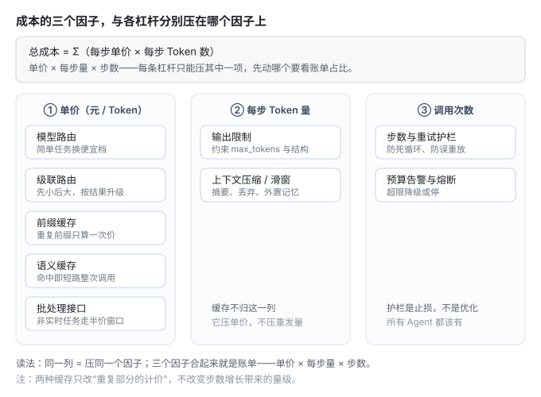
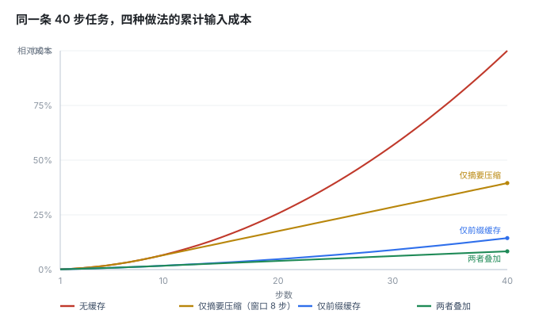

## 一、结论前置

1. **成本只有三个因子：单价 × 每步 Token 量 × 调用次数。各条杠杆不是彼此独立的事，而是分别压这三个因子**——压单价（模型路由、级联、批处理、前缀缓存、语义缓存）、压每步 Token（输出限制、上下文压缩）、压调用次数（步数上限、重试控制）。先看账单里哪一项占比最大，再决定动哪个；全套一起上，通常是在补“没有先测量”的缺失。

2. **Agent 的成本结构和单次调用不同：量会平方增长**。每一步都要重发历史，第 i 步的输入随 i 线性增长，累计计费量随步数平方增长；重试与死循环在此基础上再乘一层。前缀缓存压的是“重复部分的单价”，**不改变累计量的平方形态**；真正把曲线拉直的是摘要、滑窗、外部记忆与任务分解。

3. **成本与延迟的关系不对称**。前缀缓存同时降成本与首 Token 延迟（省掉 prefill）；流式输出只改感知延迟，账单不变；连续批处理、PagedAttention、KV 复用提升的是吞吐（单位硬件能服务多少请求），云 API 用户拿不到这部分收益，但自建推理的每 Token 成本直接受益。

4. **计费口径一变，架构约束就变**。按 Token 计费时成本风险在客户侧；转向按任务/按结果计费后，Token 成本内化到服务商侧，架构必须自带预算上限、失败兜底和成本可预测性——否则一次长尾任务就能吃掉整单利润。

---

## 二、通俗类比 + 专业定义

### 通俗类比

#### 成本与性能权衡 = 出行预算（快 / 便宜 / 准点，三选二）

- **为什么不能“全打专车”**：
  - 每个请求都上最强模型，单次质量最高，但单价也在最高档
  - 请求量一大，账单里绝大多数花在“本可以用便宜档解决的请求”上
  - 不是“AI 太贵”，是“用错了档位”

- **模型路由 = 按路程选交通工具**：
  - 短途（抽取、分类、格式化、FAQ）→ 步行/公交：便宜档够用
  - 中程（写作、总结、翻译）→ 地铁：中档
  - 长途（多步推理、代码、合同审阅）→ 飞机：强档
  - 判断依据是**任务形态**，不是用户语气或消息长度——“帮我看看这个”可能涉及长文档，“你们几点下班”就是一句话

- **前缀缓存 = 月票**：
  - 同一段开头（系统提示 + 工具定义）每次请求都一样，算过一次就存下来，之后只算新增部分
  - 它省的是“重复”，不是“长度”：前缀再长，只要逐字不变就能复用；前缀再短，每次变一个字就全失效
  - 常走这条线才划算——一次性任务办月票没意义

- **语义缓存 = FAQ 手册**：
  - 问法不同、意思一样（“怎么退款” / “退款流程是什么”），直接翻上次的答案，连推理都不用跑
  - 风险是“看起来一样其实不一样”（“退款到账要几天” ≠ “退款要几天审核”），所以要有阈值和过期机制

- **批处理 = 拼单 / 普通快递**：
  - 不着急的活攒一起，用更低的单价换更长的完成窗口
  - 适合离线评测、批量标注、夜间报表；不适合有人在等结果的交互

- **输出限制 = 打电报按字收费**：
  - 输出单价普遍高于输入单价，能一句话说清就别写三段
  - 但限得太狠会截断答案，触发重试反而更贵

- **Agent 成本 = 每次打电话都要把之前说过的话重说一遍**：
  - 不是“聊得久”贵，是“每轮重述”贵
  - 10 步和 100 步不是 10 倍关系，是量级差别

- **性能优化 = 堵车时选路线**：
  - 流式输出 = 边走边报路况：感知快，里程（账单）不变
  - 并行工具调用 = 少绕几段路：真的省时间
  - 连续批处理 / PagedAttention = 路口吞吐更大：能多过车，不等于你少付钱

### 专业定义

| 概念 | 一句话定义 |
|------|------|
| Token 成本 | 输入 Token × 输入单价 + 输出 Token × 输出单价；输出单价普遍更高。 |
| 模型路由 | 调用前按任务难度选档位，一次决策。 |
| 级联路由 | 先小模型，质量不达标再升级，用质量评估换确定性。 |
| 前缀缓存 | 复用逐字相同前缀的 KV 计算，命中部分按折扣计价。 |
| 语义缓存 | 用嵌入相似度复用历史答案，命中即跳过推理。 |
| 批处理接口 | 用更长的完成窗口换更低的单价。 |
| 输出限制 | 约束 `max_tokens` 与输出结构，压输出 Token。 |
| 上下文压缩 | 摘要、丢弃或外置历史，压每步重发量。 |
| 滑窗 | 只保留最近 N 轮，更早内容直接丢弃。 |
| TTFT | 请求到首个 Token 的时延，决定“感觉快不快”。 |
| 流式输出 | 逐 Token 返回，改感知延迟，不改总时长与账单。 |
| 连续批处理 | 一步生成结束即换入新请求，提高吞吐。 |
| PagedAttention | KV 缓存分页管理，减少显存碎片。 |
| 分块预填充 | 长前缀切块与解码交错，压尾延迟。 |
| KV 感知路由 | 按缓存所在位置选副本，避免前缀重算。 |
| O(N²) 累积 | 每步重发历史，累计计费量随步数平方增长。 |
| 缓存读取占比 | 命中读取的 Token / 总输入 Token，比“命中率”更可信。 |
| 每任务成本 | 完成任务的总花费，含失败与重试，比单次调用成本有意义。 |
| 预算熔断 | 超限即降级或终止，防长尾任务吃掉利润。 |

---

## 三、底层机制

### 一、成本的三个因子与杠杆的作用点



官方计价都长这样：`输入 Token × 输入单价 + 输出 Token × 输出单价`，Agent 再乘上步数。所以杠杆只能压三处之一，判断顺序是“先测、再改”：

| 杠杆 | 压哪个因子 | 前提 / 不该用的时候 |
|------|-----------|--------------------|
| 模型路由 | 单价 | 任务难度可预判、且有质量门槛；同质任务一刀切上强档最浪费 |
| 级联路由 | 单价（按结果） | 需要可靠的质量判定器，且判定成本要低于省下的钱 |
| 前缀缓存 | 单价（重复部分） | 要有长且逐字稳定的前缀；前缀短于门槛或每次都变则无效 |
| 语义缓存 | 单价（整次调用） | 查询重复度高、答案时效长；答案随时间变就不能缓存 |
| 批处理 | 单价 | 非实时、可攒批；交互场景不适用 |
| 输出限制 | 每步量 | 输出单价高于输入；限得过狠会截断答案并触发重试 |
| 上下文压缩 | 每步量 | 长会话、历史价值随时间衰减；摘要会丢细节，要验证 |
| 步数 / 重试护栏 | 次数 | 所有 Agent 都该有——护栏不是优化，是止损 |

### 二、前缀缓存：命中率由请求结构决定，不由开关决定

前缀缓存不是“打开就有收益”的开关，它是一组硬规则。官方文档里能查到的规则有五条，分别从内容、控制方式、计费、生命周期、路由五个角度决定命中率上限：

1. **前缀必须逐字一致**。从第一个 Token 开始比对，任何位置多一个时间戳、随机 ID、用户名，后面的缓存全部作废。厂商普遍设最小前缀长度门槛（千 Token 量级），短于门槛不缓存——这解释了一个常见现象：小系统测不出效果，接了长系统提示+工具定义之后突然“变快了”。

2. **两种控制方式**。多数实现默认自动缓存（隐式地在请求末尾附近切一段可复用前缀）；较新的模型支持显式断点，在指定内容块上标记“到这儿为止可以复用”，并对每请求可写断点数、读取时参考的断点数设了上限。显式断点的价值是可预期：你知道缓存边界在哪，而不是靠猜。

3. **计费是“写贵读便宜”**。命中部分的读取按远低于输入单价的费率计费；部分实现对缓存写入额外收费，部分不收。所以“命中率越高越省”成立，“缓存等于免费”不成立；算 ROI 时要把写入侧算进去。

4. **缓存有生命周期**。内存态缓存闲置几分钟就会被淘汰，最长保留窗口以小时计；跨工具调用间隙、跨会话的长任务，需要显式指定更长的保留时间，否则下一轮回来只剩重算。

5. **缓存是机器局部的，路由会打散它**。同一份前缀被负载均衡打到另一台机器上就是 miss，所以厂商提供缓存路由键，让同前缀请求落到同一处。反过来也有坑：**同一前缀的高并发反而更容易 miss**（同一键的请求速率过高时，部分请求会走不到有缓存的那台），高并发场景要按键分片，同时保持每个键与前缀的稳定映射。

工程含义，四条就够：

- 稳定内容在前、动态内容在后，别把工具结果插到前缀中间
- 断点放在“最长的稳定段”末尾，而不是随便找个位置
- 长任务显式延长保留时间，覆盖思考间隙
- 监控 `cached_tokens`（缓存读取量），而不是看响应快慢去猜

### 三、语义缓存：命中就整次短路

机制是四步：查询 → 嵌入 → 相似度检索 → 过阈值返回（未过阈值则回源，并把答案写回缓存）。

三个容易忽略的点：

- **阈值决定的是“错答率 vs 命中率”**。阈值太高等于没有缓存，太低会把“退款要几天审核”的答案返给“退款到账要几天”。阈值要用真实查询分布调，不能拍脑袋。
- **命中不是零成本**。嵌入调用本身要钱、要延迟；条目变多后线性检索的成本也上来了（生产环境应换成 ANN 索引）。所以“命中时成本接近零”只对**模型推理**成立，不对整条链路成立。
- **失效比缓存更重要**。政策、价格、库存一变，旧答案就是错的。要么设 TTL，要么把版本号（政策版本、商品 ID）拼进缓存键。

### 四、O(N²)：缓存能降价，不能降量



设每步新增输入 `a`、输出 `b`，第 i 步要重发的历史是 `(i-1)(a+b)`，累计计费量约等于 `N²(a+b)/2`——步数翻 10 倍，累计量翻约 100 倍。

三种干预，作用点完全不同：

| 干预 | 压什么 | 曲线形态 |
|------|--------|---------|
| 前缀缓存 | 重复部分的单价 | 仍是抛物线，整体下移 |
| 摘要 / 滑窗 | 每步重发量 | 变成近线性 |
| 任务分解 | 两者都压 | 多个小抛物线之和 |

**一个必须说准的细节**：自建推理里，KV 复用让每步只计算新增 Token，**计算量是线性的**；但云 API 按 Token 计费，缓存读取仍然计费，所以**账单依旧近似平方**，只是常数变小。两件事经常被混为一谈——“开了缓存就线性了”是错的，线性化靠的是减少重发量。

### 五、性能：先分清你优化的是哪一层

| 技术 | 主要改善 | 对账单的影响 |
|------|---------|-------------|
| 流式输出 | TTFT / 感知延迟 | 不变 |
| 并行工具调用 | 任务墙钟时间 | 基本不变（工具结果仍要回填上下文） |
| 连续批处理 | 吞吐 | 自建降本，云 API 无感 |
| PagedAttention | 显存利用率 → 吞吐 | 同上 |
| 前缀缓存 / 基数树复用 | 重复前缀的 prefill | 云 API 体现为缓存折扣 |
| 分块预填充 | 长短混跑时的尾延迟 | 自建为主 |
| KV 感知路由 | 多副本下的缓存命中率 | 自建 / 托管集群 |
| 量化 / 蒸馏 | 显存与算力 | 自建降本 |
| 多区域部署 | 网络 RTT | 与模型成本无关 |

用云 API 时，表格下半部分由厂商吸收，你直接能控制的是：**选哪档模型、请求结构是否缓存友好、上下文体积、步数与重试**。

两条有出处的量化锚点（论文实测，特定硬件与负载，不可外推为普遍收益）：

- vLLM 的 PagedAttention 在同延迟下把吞吐提升约 2–4 倍（对比 FasterTransformer / Orca）——[arXiv:2309.06180](https://arxiv.org/abs/2309.06180)
- SGLang 的 RadixAttention 前缀复用最高提升约 6.4 倍吞吐（对比当时的 SOTA 系统，取决于工作负载）——[arXiv:2312.07104](https://arxiv.org/abs/2312.07104)

### 六、成本监控与预算

| 指标 | 怎么算 | 异常信号 |
|------|--------|---------|
| 每任务成本 | 总花费 / 成功任务数 | 均值被长尾任务拉高 |
| 输入 / 输出 Token | 分档统计 | 输入涨得比步数快 → 前缀在膨胀 |
| 缓存读取占比 | 命中读取 / 总输入 | 长期接近 0 → 前缀被污染 |
| 模型分布 | 各档调用占比 | 强档占比异常上升 |
| 重试与失败率 | 重试次数 / 调用次数 | 重试贡献了显著成本 |
| 预算触发率 | 熔断 / 拒绝次数 | 频繁触发 → 预算或路由失准 |

预算是三层的，不是一个数：**告警**（相对基线漂移就报）→ **降级**（换档、压缩上下文、关掉非必要工具）→ **熔断**（终止并返回可解释的失败）。只有告警没有降级，等于只会看着账单涨。

原则一句话：**先计量，再优化**。没有 per-task 成本数据就动手砍模型的团队，通常砍掉的是质量。

---

## 四、最小可运行代码

### 示例一：零依赖成本模型（可直接运行）

先算清楚，再决定优化哪一项。所有单价用相对单位，只用于比较策略，不代表任何厂商报价。

```python
"""零依赖成本模型：比较四种做法在同样步数下的累计输入成本。

跑法：python3 cost_model.py
单位：单价为相对单位，只做横向比较，不代表任何厂商报价。
"""

NEW_INPUT = 500     # 每步新增输入 Token（用户消息 + 工具结果）
OUTPUT = 200        # 每步输出 Token
PRICE_IN = 1.0      # 输入单价（相对单位）
PRICE_OUT = 4.0     # 输出单价：多数厂商都明显高于输入
CACHE_READ = 0.1    # 命中缓存的读取折算比例（实际值以价目表为准）
WINDOW = 8          # 滑窗 / 摘要保留的历史步数上限


def step_cost(history_tokens: int, ratio: float) -> float:
    """单步成本：历史部分按 ratio 计价，新增输入与输出按原价。"""
    return (history_tokens * ratio + NEW_INPUT) * PRICE_IN + OUTPUT * PRICE_OUT


def total(steps: int, cached: bool = False, windowed: bool = False) -> float:
    """累计成本。cached=用缓存价读历史；windowed=历史被截断到固定窗口。"""
    cost = 0.0
    for i in range(1, steps + 1):
        history = (i - 1) * (NEW_INPUT + OUTPUT)          # 前 i-1 步产生的历史
        if windowed:
            history = min(history, WINDOW * (NEW_INPUT + OUTPUT))
        cost += step_cost(history, CACHE_READ if cached else 1.0)
    return cost


def main() -> None:
    print(f"{'步数':>4}{'无缓存':>12}{'仅前缀缓存':>12}{'仅滑窗':>12}{'两者叠加':>12}")
    for n in (1, 5, 10, 20, 40, 100):
        print(f"{n:>4}{total(n):>12.0f}{total(n, cached=True):>12.0f}"
              f"{total(n, windowed=True):>12.0f}"
              f"{total(n, cached=True, windowed=True):>12.0f}")

    n1, n2 = 40, 100
    print(f"\n步数 {n1} → {n2}（{n2 / n1:.1f} 倍）：无缓存累计成本放大 "
          f"{total(n2) / total(n1):.1f} 倍，仅滑窗放大 "
          f"{total(n2, windowed=True) / total(n1, windowed=True):.1f} 倍")


if __name__ == "__main__":
    main()
```

跑出来会看到两件事：步数放大 2.5 倍时，无缓存的累计成本放大到约 6 倍（平方趋势）；滑窗只有 2.7 倍左右（接近线性），而缓存只是把整条曲线按折扣往下挪。**两者叠加才是最优解**，因为它们压的是不同因子。

### 示例二：路由 + 缓存友好结构 + 语义缓存 + 预算守卫

需要环境变量（任何 OpenAI 兼容服务都行）：

```
export OPENAI_API_KEY=sk-xxx        # 你的 key
export OPENAI_BASE_URL=https://...  # 接口地址，用官方可省略
export LLM_MODEL_CHEAP=...          # 便宜档模型名
export LLM_MODEL_STRONG=...         # 强档模型名
export EMBEDDING_MODEL=...          # 嵌入模型名
export MODEL_PRICES="1,4;10,40"     # 可选：两档的（输入,输出）单价，缺省为相对单价
```

```python
"""生产链路示意：模型路由 + 缓存友好的消息结构 + 语义缓存 + 预算守卫。

跑法：python3 cost_agent.py
要点：
1) 稳定前缀（系统提示）放最前且逐字不变，才有缓存命中；
2) 用响应里的 cached_tokens 判断命中，而不是靠“感觉快”；
3) 预算在调用前检查，超限直接拒绝，不留“跑完再说”。
"""
import asyncio
import json
import math
import os

from dataclasses import dataclass

from openai import AsyncOpenAI

client = AsyncOpenAI()  # 自动读取 OPENAI_API_KEY / OPENAI_BASE_URL


def require_env(name: str) -> str:
    value = os.environ.get(name)
    if not value:
        raise SystemExit(f"缺少环境变量：{name}")
    return value


CHEAP_MODEL = require_env("LLM_MODEL_CHEAP")
STRONG_MODEL = require_env("LLM_MODEL_STRONG")
EMBED_MODEL = require_env("EMBEDDING_MODEL")

# 单价 (输入, 输出)：缺省是相对单价，接真实账单时换成 provider 价目表的数值
_raw = os.environ.get("MODEL_PRICES", "1,4;10,40").split(";")
PRICES = {
    "cheap": tuple(float(x) for x in _raw[0].split(",")),
    "strong": tuple(float(x) for x in _raw[1].split(",")),
}
MODELS = {"cheap": CHEAP_MODEL, "strong": STRONG_MODEL}

# 稳定前缀：每次请求逐字相同，这是缓存能命中的前提
SYSTEM_PREFIX = (
    "你是一个客服助手。规则：1) 回答不超过三句；"
    "2) 涉及退款、赔付时先核对订单状态；3) 不确定就说不确定。"
)


def estimate_tokens(text: str) -> int:
    """粗估 Token：CJK 字符约 1 Token/字，其余约 4 字符/Token。
    只用于预算预估，生产环境应换成 provider 的 tokenizer。"""
    cjk = sum(1 for ch in text if "\u4e00" <= ch <= "\u9fff")
    return cjk + max(1, (len(text) - cjk) // 4)


@dataclass
class Budget:
    """预算守卫：调用前检查，调用后记账。"""

    max_input_tokens: int = 50_000
    max_cost: float = 1.0
    used_input: int = 0
    used_cost: float = 0.0

    def cost_of(self, input_tokens: int, output_tokens: int, price) -> float:
        return (input_tokens * price[0] + output_tokens * price[1]) / 1_000_000

    def can_afford(self, input_tokens: int, output_tokens: int, price) -> bool:
        return (self.used_input + input_tokens <= self.max_input_tokens
                and self.used_cost + self.cost_of(input_tokens, output_tokens, price) <= self.max_cost)

    def charge(self, input_tokens: int, output_tokens: int, price) -> float:
        cost = self.cost_of(input_tokens, output_tokens, price)
        self.used_input += input_tokens
        self.used_cost += cost
        return cost


class SemanticCache:
    """语义缓存：命中就跳过推理。注意嵌入调用本身也有成本与延迟。"""

    def __init__(self, threshold: float = 0.95) -> None:
        self.threshold = threshold
        self.entries: list[tuple[list[float], str]] = []

    async def _embed(self, text: str) -> list[float]:
        resp = await client.embeddings.create(model=EMBED_MODEL, input=text)
        return resp.data[0].embedding

    async def get(self, query: str) -> str | None:
        qv = await self._embed(query)
        norm_q = math.sqrt(sum(a * a for a in qv)) or 1.0
        best, best_sim = None, 0.0
        for vec, answer in self.entries:
            norm_v = math.sqrt(sum(b * b for b in vec)) or 1.0
            sim = sum(a * b for a, b in zip(qv, vec)) / (norm_q * norm_v)
            if sim > best_sim:
                best, best_sim = answer, sim
        return best if best_sim >= self.threshold else None

    async def put(self, query: str, answer: str) -> None:
        self.entries.append((await self._embed(query), answer))


ROUTE_PROMPT = """判断这条客服请求的难度，只输出 JSON：{"tier":"cheap|strong"}
cheap：查状态、问政策、闲聊、格式化
strong：投诉定性、赔付判断、多条件推理"""


async def route(query: str) -> str:
    """用便宜档做分类器：分类本身也要花钱，所以输出限制到最短。"""
    resp = await client.chat.completions.create(
        model=CHEAP_MODEL,
        messages=[{"role": "user", "content": f"{ROUTE_PROMPT}\n\n请求：{query}"}],
        max_tokens=40,
        temperature=0,
    )
    text = resp.choices[0].message.content or ""
    try:
        tier = json.loads(text[text.index("{"):text.rindex("}") + 1]).get("tier")
    except (ValueError, json.JSONDecodeError):
        tier = "cheap"  # 解析失败按便宜档走：宁可少花钱，也不要无依据升档
    return tier if tier in MODELS else "cheap"


class CostAwareAgent:
    def __init__(self) -> None:
        self.cache = SemanticCache()
        self.budget = Budget()
        self.stats = {"calls": 0, "cache_hits": 0, "cached_tokens": 0,
                      "input_tokens": 0, "output_tokens": 0, "tiers": {}}

    async def ask(self, query: str) -> dict:
        cached = await self.cache.get(query)
        if cached:
            self.stats["cache_hits"] += 1
            return {"answer": cached, "source": "semantic_cache"}

        tier = await route(query)
        price = PRICES[tier]

        # 稳定前缀在前、动态内容在后：缓存命中率由这个结构决定
        messages = [
            {"role": "system", "content": SYSTEM_PREFIX},
            {"role": "user", "content": query},
        ]

        est_in = estimate_tokens(SYSTEM_PREFIX) + estimate_tokens(query)
        if not self.budget.can_afford(est_in, 512, price):
            return {"answer": "超出预算，已拒绝", "source": "budget"}

        resp = await client.chat.completions.create(
            model=MODELS[tier], messages=messages, max_tokens=512, temperature=0.2
        )
        answer = resp.choices[0].message.content or ""

        usage = resp.usage
        details = getattr(usage, "prompt_tokens_details", None)
        cached_tokens = getattr(details, "cached_tokens", 0) or 0
        cost = self.budget.charge(usage.prompt_tokens, usage.completion_tokens, price)

        self.stats["calls"] += 1
        self.stats["cached_tokens"] += cached_tokens
        self.stats["input_tokens"] += usage.prompt_tokens
        self.stats["output_tokens"] += usage.completion_tokens
        self.stats["tiers"][tier] = self.stats["tiers"].get(tier, 0) + 1

        await self.cache.put(query, answer)
        return {"answer": answer, "tier": tier, "cached_tokens": cached_tokens,
                "prompt_tokens": usage.prompt_tokens, "cost_units": round(cost, 6)}


async def main() -> None:
    agent = CostAwareAgent()
    for q in ["订单 A123 到哪了？", "包裹晚了一周，我要求赔付运费", "订单 A123 到哪了？"]:
        result = await agent.ask(q)
        brief = {k: v for k, v in result.items() if k != "answer"}
        print(f"{q} → {brief}")

    s = agent.stats
    ratio = s["cached_tokens"] / s["input_tokens"] if s["input_tokens"] else 0.0
    print(f"\n调用 {s['calls']} 次，语义缓存命中 {s['cache_hits']} 次，"
          f"缓存读取占比 {ratio:.0%}，档位分布 {s['tiers']}")


if __name__ == "__main__":
    asyncio.run(main())
```

两处需要留意的实测现象：**前缀短于厂商的最小缓存门槛时，`cached_tokens` 恒为 0**——示例里的系统提示就是短前缀，真实系统要有足够长的稳定段（工具定义、业务规则、few-shot 示例）才有折扣；**语义缓存对第三条重复问题生效**，但它用的是第一次的答案，如果答案有时效（库存、活动价），必须带 TTL 或版本键。

---

## 五、易混对比

| 维度 | 前缀缓存 | 语义缓存 |
|------|---------|---------|
| 缓存对象 | 前缀的 KV 计算 | 完整问答对 |
| 命中条件 | 前缀逐字相同 | 语义相似度过阈值 |
| 省的是什么 | 重复的 prefill | 整次推理 |
| 需要什么 | 稳定的请求结构 | 嵌入模型 + 向量检索 |
| 失效风险 | 前缀被污染 | 相似但答案不同 |
| 典型场景 | 固定系统提示 + 工具定义 | FAQ、重复咨询 |

| 维度 | 模型路由 | 级联路由 |
|------|---------|---------|
| 决策时机 | 调用前一次判定 | 调用后按质量决定是否升级 |
| 延迟 | 低，通常只多一次分类调用 | 高位时多次调用叠加 |
| 成本上限 | 取决于分类器准确率 | 最坏情况付满所有档位 |
| 质量兜底 | 无，错判就直接错 | 有，小模型不行还有大模型 |
| 实现成本 | 规则即可起步 | 需要可靠的质量判定器 |
| 适用 | 任务形态可预判 | 形态难判、错答代价高 |

| 维度 | 流式输出 | 非流式 |
|------|---------|--------|
| 返回方式 | 逐 Token 返回 | 全部生成后返回 |
| TTFT | 明显更低 | 等于整段生成时间 |
| 总时长 / 账单 | 不变 / 不变 | 不变 / 不变 |
| 实现成本 | 中，要处理流与中断 | 低 |
| 适用 | 对话、写作、长输出 | 批处理、结构化抽取 |

| 维度 | 批处理接口 | 实时接口 |
|------|-----------|---------|
| 单价 | 显著低于实时 | 标准价 |
| 完成时效 | 小时级窗口 | 秒级 |
| 适用 | 离线评测、批量加工 | 有人等结果的交互 |
| 代价 | 不能中途改需求 | 单价高 |

| 维度 | 上下文压缩 | 滑窗 |
|------|-----------|------|
| 做法 | 摘要 / 结构化抽取历史 | 只留最近 N 轮 |
| 信息保留 | 中，摘要会丢细节 | 低，早期直接丢 |
| 额外成本 | 摘要本身要调用模型 | 无 |
| 适用 | 长会话且历史有价值 | 短会话或历史价值低 |
| 常见组合 | 近期原文 + 早期摘要 | 与摘要配合使用 |

---

## 六、3 个实战坑

### 坑 1：所有任务都用最强模型——账单里绝大多数花在本可以降级的请求上

**现象**：团队图省事，全链路用同一档强模型。上线后成本远超预算，逐条抽样才发现：查政策、查订单状态、格式化输出这类请求占了大多数，而它们用便宜档就能达到同样效果；真正需要强模型的只有投诉定性、多条件赔付判断这类少数。

**根因**：没有按任务难度分层，把“最高质量”当成了默认值。

#### 避坑

先上规则路由（一天能落地），跑一周收集错判样本，再决定要不要上分类器：

```python
CHEAP_HINTS = ("营业时间", "地址", "怎么查", "政策", "退换", "发票", "格式化")
STRONG_HINTS = ("投诉", "赔付", "责任", "合同", "对比", "为什么", "评估")


def route_by_rules(message: str) -> str:
    """规则路由：先粗分，再用错判样本迭代。返回档位键，不写死模型名。"""
    if any(k in message for k in STRONG_HINTS):
        return "strong"
    if any(k in message for k in CHEAP_HINTS):
        return "cheap"
    if len(message) > 200:      # 长消息多半要通读材料，默认升档更稳
        return "strong"
    return "cheap"
```

三条必须配的验收动作：

- **A/B 对比**：同一批真实请求分别走两档，人工或判定器打分，确认降档不掉质量
- **记录错判**：路由判错的样本进数据集，规则和分类器都靠它迭代
- **设降级兜底**：强档不可用或超预算时降档返回，而不是直接报错

成本估算只用相对量：设便宜档单价是强档的 1/10，若八成请求可降级，加权单价约降到 `0.8×0.1 + 0.2×1 = 0.28`，即约三成。**这个比例比绝对金额更有用**，因为价目表会变，比例结构不会。

### 坑 2：前缀被污染——命中率上不去，钱照花

**现象**：开了缓存，成本几乎没降。查 `cached_tokens` 发现长期接近 0。

#### 避坑

**四种典型污染源**，按出现频率排：

| 污染源 | 表现 | 修法 |
|--------|------|------|
| 动态内容插在前缀里 | 时间戳、会话 ID、用户名进系统提示 | 移出前缀，或放到末尾 |
| 工具结果回填到中间 | 每轮把工具返回塞进历史前段 | 工具结果一律追加在末尾 |
| 前缀里带排序不稳定的列表 | 工具清单顺序每次不同 | 固定序列化顺序、去掉非确定性字段 |
| 负载均衡打散 | 同前缀落到不同副本 | 用缓存路由键绑定前缀与副本 |

错误与正确结构的差别只有一处：**稳定段是不是真的逐字不变**。

```python
# ❌ 前缀从第二条起就变，后面全部失效
bad = [
    {"role": "system", "content": f"你是客服助手，当前时间 {now()}，会话 {sid}"},
    {"role": "user", "content": query},
]

# ✅ 稳定段逐字不变，动态内容一律后置
good = [
    {"role": "system", "content": SYSTEM_RULES},          # 规则、工具定义、示例
    {"role": "system", "content": TOOL_SCHEMA},           # 序列化顺序固定
    {"role": "user", "content": f"[会话 {sid}]\n{query}"},  # 动态内容放在后面
]
```

判定命中只看一个字段：响应里的 `cached_tokens`（缓存读取量）与 `prompt_tokens` 的比值。它长期接近 0，说明结构有问题，不要凭“响应快了点”就认为生效。

### 坑 3：长任务没有护栏——死循环跑到预算耗尽才被发现

**现象**：某个任务跑了很久，账单异常。回放轨迹发现 Agent 反复调用同一个工具、拿到同样结果、继续调用，没有任何机制让它停。

**根因**：只有“成功路径”，没有“失败路径”的成本护栏。

#### 避坑

护栏要分层，单靠一层都会被绕过：

| 层 | 机制 | 防什么 |
|----|------|--------|
| L1 | 最大步数 | 死循环 |
| L2 | 连续重复动作检测 | 原地打转 |
| L3 | 无进展检测（结果不变） | 有变化但没推进 |
| L4 | 每任务 Token / 成本预算 | 成本爆炸 |
| L5 | 单步超时 + 整体超时 | 卡死 |
| L6 | 预算告警 / 熔断 | 失控后无人知晓 |

```python
import asyncio

MAX_STEPS = 15
STEP_TIMEOUT = 30
TASK_TIMEOUT = 300


def repeated(trace: list[dict], n: int = 3) -> bool:
    """最近 n 步是同一个工具、同一个入参 → 判为重复。"""
    if len(trace) < n:
        return False
    recent = trace[-n:]
    key = {(s["tool"], s["args"]) for s in recent}
    return len(key) == 1


def no_progress(trace: list[dict], n: int = 5) -> bool:
    """最近 n 步工具结果完全一致 → 判为无进展。"""
    if len(trace) < n:
        return False
    return len({s.get("result") for s in trace[-n:]}) == 1


async def run_task(task: dict, budget, price, step_fn) -> dict:
    """执行一个任务：整体超时 + 步数上限 + 预算前置检查。
    budget 为示例二里的 Budget 实例，price 为该档位的 (输入, 输出) 单价。"""
    try:
        return await asyncio.wait_for(_loop(task, budget, price, step_fn), timeout=TASK_TIMEOUT)
    except asyncio.TimeoutError:
        return {"status": "failed", "error": "任务整体超时"}


async def _loop(task: dict, budget, price, step_fn) -> dict:
    trace: list[dict] = []
    for _ in range(MAX_STEPS):
        if repeated(trace) or no_progress(trace):
            return {"status": "failed", "error": "检测到空转，已终止"}
        if not budget.can_afford(budget.max_input_tokens // MAX_STEPS, 512, price):
            return {"status": "failed", "error": "超出预算，已终止"}

        step = await asyncio.wait_for(step_fn(task, trace), timeout=STEP_TIMEOUT)
        trace.append(step)
        if step.get("done"):
            return {"status": "ok", "result": step["result"], "steps": len(trace)}

    return {"status": "failed", "error": f"超过最大步数 {MAX_STEPS}"}
```

护栏的定位要摆正：**它不省钱，它止损**。真正的省来自前面两个坑（少跑没必要的请求、让重复前缀真的命中）。

---

## 七、进阶问题（引导往下挖）

### 问题 1：任务越做越长，O(N²) 会越来越严重吗？有没有根本解法？“上下文纪律”具体怎么做？

#### 引导思考

- **短期会更严重，这是推断而非结论**：任务从单轮问答转向多步执行（多工具、多轮次、多模态），步数上限被不断抬高，而“每步重发历史”这件事在 API 计费模型里没有改变。
- **中期看工程，不靠架构突破**：摘要质量、工具结果外置、子任务隔离，这三件事能覆盖大部分长任务的成本问题，且不依赖模型换代。
- **长期可能被架构改写**：线性注意力、状态空间模型、超长上下文这批方向，如果落地，会把“上下文长度 = 成本”这条绑定松开。这属于判断，不是现状。

根本解法分四类，各自代价不同：

| 方案 | 思路 | 代价 |
|------|------|------|
| 外部记忆 | 历史存库，按需检索片段 | 检索可能漏关键信息 |
| 分层摘要 | 近期原文、中期摘要、远期丢弃 | 摘要丢细节，要验证 |
| 任务分解 | 大任务拆成不共享上下文的子任务 | 子任务间信息传递要设计 |
| 增量计算 | 只算新增 Token（KV 复用） | 自建才行，云 API 仍是按量计费 |

**上下文纪律**的落地清单：

1. **工具结果分级处理**：小结果原文入上下文；中等结果摘要 + 保留引用；大结果只存 ID，需要时再取
2. **滑窗 + 摘要组合**：近期 N 轮原文，更早的滚成一段摘要，摘要本身也要限长
3. **稳定段与动态段分离**：系统提示、工具定义在前且不动，用户输入、工具结果追加在后
4. **每步审计体积**：记录每步 `prompt_tokens`，出现异常增长就触发压缩，而不是等超窗
5. **给预算，不给“尽量省”**：每任务 Token 上限写进配置，超限降级或终止

### 问题 2：从“按 Token 计费”到“按任务 / 按结果计费”，会怎么改变 Agent 架构？

#### 引导思考

行业趋势（判断，不含具体年份与数值）：推理侧支出在 AI 总支出中的占比长期上升，成本优化重心从训练侧转向推理侧；同时客户越来越倾向为“任务完成”买单，而不是为 Token 买单。

计费口径换了，风险归属就换了：

| 口径 | 谁承担什么 | 架构含义 |
|------|-----------|---------|
| 按 Token | 客户担单价 × 用量；服务商几乎无风险 | 成本可控性差，客户有成本焦虑 |
| 按任务 | 客户付每任务定价；服务商担单任务的实际用量 | 必须压低每任务用量的方差 |
| 按结果 | 客户付每成功结果；服务商担失败任务的全部成本 | 必须提高成功率并控制失败成本 |

由此带来的五个架构约束：

1. **成本内化**：单价由服务商付，缓存结构、路由、上下文体积从“优化项”变成“产品功能”
2. **方差管理**：按任务计费最怕长尾——均值再低，一次 100 步的任务就吃掉几十单利润
3. **成功率优先于单价**：按结果计费时，一次失败的成本高于一次用强模型的成本，级联与兜底的价值上升
4. **失败要快速失败**：护栏前置，别等烧完预算才知道做不成
5. **可预测性**：对外承诺的价格必须对应可承诺的成本上限，否则规模越大亏得越多

一句话总结：**按 Token 计费时，成本是账单问题；按结果计费时，成本是产品设计问题。**

（本知识点是课程 39 个知识点的最后一个。至此，从基础概念、核心机制、架构模式、工程落地、框架工具到评估与生产，六层已闭环，后续用四关自测逐条巩固即可。）

---

## 八、四关自测

### 复述关（3 句话讲清）

1. **成本只有三个因子——单价、每步 Token 量、调用次数**，各条杠杆分别压其中之一；先测量账单占比，再决定动哪一项。
2. **Agent 的成本随步数平方增长**，因为每步都要重发历史；前缀缓存只压低重复部分的单价，不改变平方形态，真正拉直曲线的是摘要、滑窗、外部记忆与任务分解。
3. **性能优化要分清层次**：流式改感知、并行改墙钟、批处理与 PagedAttention 改吞吐，云 API 用户能直接控制的仍是选档、请求结构、上下文体积和步数。

### 举例关（真实场景）

客服 Agent 的组合拳：查状态、问政策走便宜档，投诉定性与赔付判断走强档；系统提示与工具定义逐字固定放最前，动态内容全部后置，用 `cached_tokens` 验证命中；重复咨询走语义缓存；夜间批量标注走批处理接口；每任务设 Token 与步数上限。这套组合压的是不同因子，不能互相替代。

### 反例关（边界条件）

全链路只用强模型、且前缀里塞了时间戳——账单高，缓存还基本不命中；另一个极端是为了省钱把所有请求塞给便宜档、又不做质量监控，错答率上升，按结果计费时赔得更多。两个反例指向同一条边界：**降本必须以可测量的质量为前提**，路由、缓存结构、护栏三件套缺一不可。

### 教学关（给小白讲）

Agent 花钱像打电话：每说一句，都要把前面说过的重说一遍，所以越聊越贵。省钱三招——能坐公交（便宜档）就别打车（强档）；常走的路线办月票（前缀缓存）；发现原地打转就挂电话（步数上限和预算）。将来客户也不按“通话分钟数”付钱，而是按“事情办成没有”付钱。

---

## 资料来源

- 官方文档：[Azure OpenAI — Prompt caching](https://learn.microsoft.com/azure/ai-foundry/openai/how-to/prompt-caching)　最小前缀长度、隐式/显式断点、写入与读取计费、保留与淘汰、缓存路由键
- 官方文档：[Azure OpenAI — Batch](https://learn.microsoft.com/azure/ai-foundry/openai/how-to/batch)　批处理定价、完成窗口、单批请求数与文件体积上限、独立配额
- 官方文档：[OpenAI — Pricing](https://openai.com/api/pricing/)　价目表入口（单价随时调整，正文不写具体数值，以此页为准）
- 论文：[vLLM / PagedAttention (arXiv:2309.06180)](https://arxiv.org/abs/2309.06180)　同延迟下吞吐约 2–4 倍
- 论文：[SGLang / RadixAttention (arXiv:2312.07104)](https://arxiv.org/abs/2312.07104)　前缀复用最高约 6.4 倍吞吐
- 论文：[FrugalGPT (arXiv:2305.05176)](https://arxiv.org/abs/2305.05176)　LLM 级联可在保持质量的同时大幅降本（最高约 98%）
- 官方文档：[NVIDIA Dynamo — Full-Stack Optimizations for Agentic Inference](https://docs.nvidia.com/dynamo/v1.1.0/blog/agentic-inference)　WORM 前缀模式、工具调用间隙导致的缓存淘汰、KV 感知路由与全局索引
