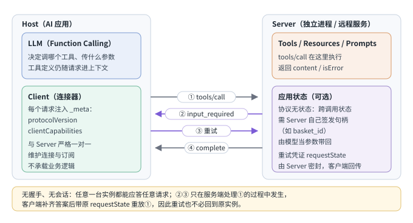

## 一、结论前置

1. **MCP（Model Context Protocol，模型上下文协议）是 Anthropic 于 2024 年 11 月发布的开放标准协议，基于 JSON-RPC 2.0，用于标准化 AI 应用与外部工具/数据源之间的连接——常被类比为“AI 时代的 USB-C”，任何兼容的 Host（Claude、ChatGPT、Cursor、VS Code Copilot）都可以接上任何兼容的 Server，发现并使用其能力**。2025 年 12 月 9 日，Anthropic 把 MCP 捐赠给 Linux 基金会下新成立的 Agentic AI Foundation（AAIF，Anthropic、Block、OpenAI 共同发起），MCP 成为该基金会创始项目之一，治理与维护者结构不变。MCP 采用 **Host-Client-Server 架构**：Host 是用户交互的 AI 应用，Client 是 Host 内的连接器（与 Server 一对一），Server 是提供能力的独立进程或远程服务。Server 侧三种核心原语：**Tools（可调用工具）、Resources（只读上下文与数据）、Prompts（可复用提示词模板）**；Client 侧的核心能力是 **Elicitation（服务器向用户追问信息）**。**MCP 的核心价值是“一次开发，到处可用”——写一个 MCP Server，可以被所有支持 MCP 的 AI 客户端使用，不需要为每个平台单独写集成代码**。

   需要单独记一句：**规范已走到无状态架构**。当前最新修订是 `2026-07-28`（2026 年 5 月 21 日锁定 RC，7 月 28 日正式发布），取消了 `initialize` 握手与协议级会话，每个请求自带协议版本与客户端能力；同时把 Roots、Sampling、Logging 三个老特性列入弃用。网上（包括本仓库旧稿）大量“先 initialize、再 tools/list”的讲解描述的是 `2025-11-25` 及更早的行为，读代码和排错时要先确认对端协商的版本。

2. **MCP vs Function Calling 是互补关系，不是替代——Function Calling 是模型级能力（LLM 输出结构化的工具调用意图，指定调谁、传什么参数），解决“模型想调什么”；MCP 是系统间通信协议（JSON-RPC、独立 Server 进程），解决“怎么把这次调用可靠地送到外部程序并拿回结果”**。**顺序上要先说清：同一条调用链里，Function Calling 在上游（LLM 侧决策），MCP 在下游（传输与执行）**——LLM 决定调工具 → Host 把这次意图翻译成 MCP 的 `tools/call` → Client 发给 Server 执行 → 结果回到 Host 上下文。两者不是“上层包下层”的替代关系，而是各自负责一段。

   这里有个常见误解要纠正：**MCP 并不能让“工具 Schema 不必每次传给模型”**。Server 的工具清单经 `tools/list` 拿到后，Host 仍要把它们转成模型 API 的工具定义随请求送入上下文——这正是上下文膨胀的来源。MCP 真正省掉的是“每个客户端各写一遍集成代码”；`2026-07-28` 又补了两条缓解手段：`tools/list` 建议返回稳定顺序（SHOULD，提高 prompt cache 命中率），列表结果带 `ttlMs` / `cacheScope`（客户端可缓存，减少重复拉取）。

3. **`2026-07-28` 是 MCP 发布以来最大的一次修订，共四项主线：协议层无状态化、把扩展（Extensions）升级为一等机制、授权对齐 OAuth 2.0 / OpenID Connect、建立正式的弃用（deprecation）政策**。无状态化是破坏性变更：删掉 `initialize` / `notifications/initialized` 握手与 `Mcp-Session-Id`，改为每个请求在 `_meta` 里自带协议版本与客户端能力，另加 `server/discover` 让客户端一次问清服务端能力；任何一次请求都可以落在任意一台实例上，普通轮询负载均衡即可水平扩展。扩展层现有 **Tasks**（长时间运行的异步任务，`tasks/get` / `tasks/update` / `tasks/cancel`）与 **MCP Apps**（Server 提供 HTML 界面，Host 在沙箱 iframe 内渲染）两个官方扩展。

   生态侧：MCP 已被 Claude、ChatGPT、Cursor、Gemini、Microsoft Copilot、VS Code 等客户端支持；官方 SDK 覆盖 TypeScript / Python / C# / Go / Rust / Ruby（Tier 1）、Java（Tier 2）、Swift / PHP / Kotlin（Tier 3），并按一致性测试划分等级；官方另设 Registry 目录用于发现和分发 Server，官方仓库只保留少量参考实现（Everything、Fetch、Filesystem、Git、Memory、Sequential Thinking、Time）。**MCP 正在成为 AI Agent 时代的“工具接口标准”——就像 LSP（Language Server Protocol）统一了编辑器和语言服务器的通信，MCP 在统一 AI 客户端和工具服务器的通信；规范原文也明确写了设计受 LSP 启发**。

---

## 二、通俗类比 + 专业定义

### 通俗类比

#### MCP = AI 时代的“USB-C 接口标准”

- **USB-C 的本质**：
  - USB-C 是一个通用接口标准——任何支持 USB-C 的设备（手机、电脑、显示器、充电器）都可以互相连接
  - 不需要为每个设备单独准备专用的线和接口
  - 一次设计（USB-C 标准），到处可用
  - 充电、数据传输、视频输出都可以通过同一个接口

- **MCP 的本质**：
  - MCP 是 AI 工具的“通用接口标准”——任何支持 MCP 的 AI 客户端（Claude、ChatGPT、Cursor）都可以连接任何支持 MCP 的工具服务器（GitHub、数据库、文件系统）
  - 不需要为每个 AI 客户端单独写工具集成代码
  - 一次开发（MCP Server），到处可用（所有支持 MCP 的客户端）
  - 工具调用、数据读取、提示词模板都可以通过同一个协议

- **Host（宿主）= 你的电脑（有 USB-C 接口）**：
  - Host 是用户直接交互的 AI 应用——Claude Desktop、Cursor、VS Code Copilot、你自己开发的 Agent
  - 就像你的电脑有 USB-C 接口，可以插各种设备
  - Host 负责：管理用户对话、调用大模型、显示用户界面、执行安全策略
  - Host 可以同时连接多个 MCP Server（就像电脑可以同时插鼠标、键盘、U 盘）

- **Client（客户端）= USB-C 接口里的“连接器”**：
  - Client 是 Host 内部的组件，负责与一个 MCP Server 建立连接
  - 就像 USB-C 接口内部的连接器，负责与插入的设备通信
  - 每个 Client 与一个 Server 严格一对一；连接由 Client 维护，但协议层已无状态（`2026-07-28`），版本与能力随每个请求携带
  - Host 可以运行多个 Client，每个连接一个不同的 Server

- **Server（服务器）= USB-C 设备（鼠标、键盘、U 盘）**：
  - Server 是提供具体能力的外部程序——可以是本地进程（通过 STDIO 通信），也可以是远程服务（通过 HTTP 通信）
  - 就像 USB-C 设备，插入后自动被识别，可以使用其功能
  - Server 对外暴露三种原语，Client 侧则提供一种能力：
    - **Tools（工具）= 设备的“操作功能”**——可以调用执行操作（如鼠标的“点击”、键盘的“输入”、U 盘的“写入文件”）。工具允许有副作用，但**不强制有副作用**：只读能力也可以做成 Tool，用 `annotations`（`readOnlyHint` / `destructiveHint` / `idempotentHint` / `openWorldHint`）声明行为，Host 再据此决定要不要弹确认。注意规范明确要求把工具描述与 annotations 当作不可信输入，除非 Server 本身可信。
    - **Resources（资源）= 设备的“存储内容”**——语义上只读的上下文数据（如 U 盘里的文件、相机里的照片），用 URI 标识。**读不读、怎么用由 Host 决定**（有的 Host 直接当附件塞进上下文，有的让模型按 URI 主动取），所以“只读就一律改 Resource”不是普适规则，要看目标 Host 的实现。
    - **Prompts（提示词）= 设备的“预设模式”**——可复用的 Prompt 模板（如相机的“人像模式”、“夜景模式”）。由用户/客户端主动选用，参数是字符串，渲染后成为一段消息。
    - **Elicitation（反问）= 设备的“请确认”提示**——这是 Client 提供的能力：Server 在处理某次请求的过程中，可以要求 Host 向用户追问一个缺失信息（例如“删这 3 个文件，确认吗？”）。`2026-07-28` 起这类“服务端发起、客户端应答”的交互统一走 Multi Round-Trip Requests：Server 先返回 `input_required` 结果，Client 补齐答案后带着原请求重试，不再依赖常连的 SSE 回推。

- **JSON-RPC 2.0 = USB-C 的“通信协议”**：
  - USB-C 设备和电脑之间需要一套通信协议来传递数据（USB 协议）
  - MCP 的 Client 和 Server 之间用 JSON-RPC 2.0 通信——发送请求、返回响应、通知
  - JSON-RPC 是一种轻量级的远程过程调用协议，用 JSON 格式传递消息
  - 就像 USB 协议定义了“怎么传数据”，JSON-RPC 定义了“怎么调用工具、怎么返回结果”

- **STDIO 传输 = 直接插在电脑上的 USB 设备**：
  - 本地 MCP Server 通过标准输入输出（STDIN/STDOUT）与 Host 通信
  - 就像直接插在电脑 USB 口上的鼠标、键盘——不需要网络，速度快，延迟低
  - 适合本地工具（文件系统、本地脚本、本地数据库）

- **Streamable HTTP 传输 = 通过网络连接的 USB 设备（如网络打印机）**：
  - 远程 MCP Server 通过 HTTP 与 Host 通信
  - 就像网络打印机、网络存储——通过网络连接，可以在任何地方访问
  - 适合远程服务（云 API、SaaS 工具、团队共享的 Server）
  - `2026-07-28` 起协议层无状态：不再需要会话粘性与共享会话存储，普通轮询负载均衡就能横向扩展；代价是**断了就是断了**——SSE 流的断点续传（`Last-Event-ID`）已被删除，流中断必须换新 request id 重发整个请求

- **MCP 的“动态发现”= USB 设备的“即插即用”**：
  - 插入 USB 设备后，电脑自动识别设备类型和功能（“检测到鼠标”、“检测到 U 盘”）
  - MCP Client 连接 Server 后，自动发现 Server 提供的 Tools、Resources、Prompts
  - 不需要手动配置——Server 说“我有这些工具”，Client 自动获取并展示给 LLM
  - LLM 就可以自动选择和调用这些工具

- **MCP Apps（官方扩展）= 带屏幕的 USB 设备（如带显示屏的机械键盘）**：
  - 普通 USB 设备只有功能，没有界面
  - 带屏幕的 USB 设备可以显示信息（如键盘的小屏幕显示当前配置）
  - MCP Apps 让 Server 预先声明一组 HTML 界面模板，Host 在**沙箱 iframe** 里渲染——不只是提供工具，还可以提供可视化界面
  - 界面里发起的每个动作都走同一套 JSON-RPC 与授权/审计链路，不会绕过工具调用的用户同意
  - 例如：一个“画图 MCP Server”可以在 Host 里显示一个画布，用户和 AI 可以共同编辑

- **Tasks 扩展（官方扩展）= 后台运行的 USB 设备（如下载器）**：
  - 普通 USB 操作是同步的——点击鼠标立即响应
  - 下载器是异步的——开始下载后，后台运行，完成后通知
  - Tasks 支持长时间运行的工作：Server 可以把一次 `tools/call` 直接答成“任务句柄”，由客户端用 `tasks/get` 轮询、用 `tasks/update` 中途补输入、用 `tasks/cancel` 取消
  - 任务是**服务器决定**的（客户端声明支持扩展，是否走任务由 Server 判断），旧的 `tasks/list` 因无法在无会话前提下安全限定范围已被删除
  - 适合：批量处理、大数据分析、长时间运行的脚本

### 专业定义

| 概念 | 定义 |
|------|------|
| **MCP（Model Context Protocol）** | 模型上下文协议，由 Anthropic 于 2024 年 11 月发布的开放标准协议，基于 JSON-RPC 2.0，用于标准化 AI 应用（Host）与外部工具/数据源（Server）之间的连接。2025 年 12 月 9 日捐赠给 Linux 基金会下的 Agentic AI Foundation（AAIF）。当前修订 `2026-07-28` 为无状态协议。 |
| **Host（宿主）** | 用户直接交互的 AI 应用，如 Claude Desktop、Cursor、VS Code Copilot、自定义 Agent。负责管理用户对话、模型调用、用户界面、安全策略与用户同意。一个 Host 创建并管理多个 Client。 |
| **Client（客户端）** | Host 内部的连接器组件，与一个 Server 严格一对一。负责协议通信、消息序列化/反序列化、订阅与通知、以及在每个请求上携带协议版本与自身能力。协议层无状态，但连接本身仍由 Client 维护。 |
| **Server（服务器）** | 提供工具、资源、提示词的外部程序。可以是本地进程（STDIO 传输）或远程服务（Streamable HTTP 传输）。独立进程或独立服务，与 Host 隔离，只能通过协议通信。 |
| **Tools（工具）** | MCP 的 Server 原语之一，模型可调用的函数，名称 + 描述 + `inputSchema`（JSON Schema 2020-12）+ 可选 `outputSchema`。工具**允许**有副作用，也常用于只读操作；行为通过 `annotations` 声明，且规范要求 Host 把描述与 annotations 视为不可信输入。 |
| **Resources（资源）** | MCP 的 Server 原语之一，以 URI 标识的只读上下文数据（文本或二进制），可带 `mimeType`、名称、描述，支持 URI 模板（RFC 6570）。是否、何时读取由 Host 决定。 |
| **Prompts（提示词）** | MCP 的 Server 原语之一，由用户/客户端选用的可复用消息模板。每个 Prompt 有名称、描述、参数列表（参数为字符串），`prompts/get` 返回渲染后的消息序列。 |
| **Elicitation（反问）** | MCP 的 Client 原语，Server 在处理某次请求时可要求 Host 向用户补问一个信息（表单或 URL 跳转两种模式）。`2026-07-28` 起通过 Multi Round-Trip Requests 交付，且只在处理某个请求的过程中允许发起。 |
| **JSON-RPC 2.0** | 轻量级远程过程调用协议，用 JSON 格式传递消息。MCP 的底层通信协议，支持请求/响应和通知两种消息类型。 |
| **STDIO Transport** | MCP 的本地传输方式，Host 把 Server 作为子进程启动，通过标准输入输出（STDIN/STDOUT）通信。适合本地工具，不经过网络，Server 生命周期与父进程绑定。 |
| **Streamable HTTP Transport** | MCP 的远程传输方式：POST 发 JSON-RPC，响应可用 JSON 或 SSE 流。适合远程服务、可独立部署扩展。早期的 HTTP+SSE 双端点传输自 `2025-03-26` 被它取代，`2026-07-28` 正式列入 Deprecated。 |
| **Data Layer（数据层）** | 旧文档对“消息语义层”的叫法（相对传输层是内层）：定义 JSON-RPC 方法语义——原语、能力声明、错误码、进度与取消等。注意 `2026-07-28` 官方架构页已不再用这套命名，而是按组件（Host/Client/Server）与逐请求能力协商来组织。 |
| **Transport Layer（传输层）** | 旧文档对“传输机制”的叫法（外层）：定义字节怎么走——连接建立、消息帧、请求头（`Mcp-Method` / `Mcp-Name`）、授权。 |
| **Capability Discovery（能力发现）** | `2026-07-28` 起由 `server/discover` 承担：Server 必须实现该方法，用它公布支持的协议版本、能力与身份；Client 可在任何请求之前先问一次，也可拿它做兼容性探测。旧版本则是靠 `initialize` 应答返回能力。 |
| **Notifications（通知）** | JSON-RPC 的消息类型之一，不需要响应的单向消息。`2026-07-28` 起，列表变更类通知统一走 `subscriptions/listen` 这一条长连流（客户端按需订阅 `toolsListChanged` / `promptsListChanged` / `resourcesListChanged` / `resourceSubscriptions`）；进度、日志这类只与某次请求相关的通知，走该请求自己的响应流。 |
| **Sampling（采样，已弃用）** | 旧特性：Server 反过来请求 Host 侧 LLM 生成内容。`2026-07-28` 起列入 Deprecated，官方建议改为 Server 直接对接 LLM 供应商 API。 |
| **Roots（根目录，已弃用）** | 旧特性：Host 向 Server 声明一组允许访问的根目录。`2026-07-28` 起列入 Deprecated，官方建议改用工具参数、Resource URI 或 Server 配置来表达访问范围。 |
| **MCP Apps** | 官方扩展。Server 预先声明 HTML 界面模板，Host 在沙箱 iframe 中渲染（图表、表单、播放器等），界面动作与工具调用共用同一套授权与审计链路。 |
| **Tasks Extension** | 官方扩展（`2025-11-25` 曾以实验性核心特性出现）。Server 可把一次调用答成任务句柄，客户端用 `tasks/get` 轮询、`tasks/update` 中途补输入、`tasks/cancel` 取消；`tasks/list` 已移除。是否走任务由 Server 决定。 |
| **Extensions（扩展机制）** | `2026-07-28` 正式化的框架：扩展以反向域名 ID 标识，通过 `ClientCapabilities` / `ServerCapabilities` 的 `extensions` 字段协商，独立于规范版本演进。现有官方扩展包括 Tasks、MCP Apps，另有 Skills over MCP 等方向。 |
| **Multi Round-Trip Requests（MRTR）** | `2026-07-28` 引入的交互模式，取代“Server 主动向 Client 发请求”：Server 先返回 `resultType: "input_required"` 与 `inputRequests`，Client 收集答案后带 `inputResponses` 与原 `requestState` 重试原请求。好处是任意实例都能接住这次重试。 |
| **Function Calling** | 大模型的能力：LLM 按宿主提供的工具定义，输出结构化的工具调用意图（工具名 + 参数）。模型级特性，各家 API 的字段格式不同。它在调用链上游负责“调什么”，MCP 在下游负责“怎么送到 Server 执行”，两者互补。 |
| **LSP（Language Server Protocol）** | 语言服务器协议，微软提出的开放标准，标准化编辑器和语言服务器之间的通信。MCP 的设计灵感来源于 LSP。 |
| **Agentic AI Foundation（AAIF）** | Linux 基金会下的定向基金，2025 年 12 月 9 日成立，由 Anthropic、Block、OpenAI 共同发起，AWS、Bloomberg、Cloudflare、Google、Microsoft 等为白金成员。MCP 是其创始项目之一（另两个是 goose、AGENTS.md），治理与维护者结构不变，基金会只提供中立归属与基础设施。 |
| **MCP Registry** | MCP 的官方目录服务，用于发现和分发 Server，取代“在参考实现仓库里翻列表”的旧做法。 |

---

## 三、底层机制

### 一、MCP 的整体架构

```
┌─────────────────────────────────────────────────────────────┐
│                      MCP 架构                                 │
├─────────────────────────────────────────────────────────────┤
│                                                             │
│  ┌─────────────────────────────────────────────────────┐   │
│  │                   Host（宿主）                         │   │
│  │  用户交互的 AI 应用                                    │   │
│  │  • Claude Desktop  • Cursor  • VS Code Copilot       │   │
│  │  • 自定义 Agent  • 其他 AI 客户端                      │   │
│  │                                                       │   │
│  │  职责：                                                │   │
│  │  • 管理用户对话和应用生命周期                           │   │
│  │  • 调用大模型（LLM）                                   │   │
│  │  • 执行安全策略和同意要求                               │   │
│  │  • 处理用户授权决策                                     │   │
│  │  • 显示用户界面                                         │   │
│  └──────────────────────┬──────────────────────────────┘   │
│                         │                                   │
│         ┌───────────────┼───────────────┐                   │
│         │               │               │                   │
│  ┌──────▼──────┐ ┌──────▼──────┐ ┌──────▼──────┐          │
│  │  Client 1   │ │  Client 2   │ │  Client 3   │          │
│  │  (连接器)    │ │  (连接器)    │ │  (连接器)    │          │
│  └──────┬──────┘ └──────┬──────┘ └──────┬──────┘          │
│         │               │               │                   │
│         │ JSON-RPC 2.0  │ JSON-RPC 2.0  │ JSON-RPC 2.0    │
│         │ (STDIO/HTTP)  │ (STDIO/HTTP)  │ (STDIO/HTTP)    │
│         │               │               │                   │
│  ┌──────▼──────┐ ┌──────▼──────┐ ┌──────▼──────┐          │
│  │  Server 1   │ │  Server 2   │ │  Server 3   │          │
│  │  (独立进程)  │ │  (独立进程)  │ │  (独立进程)  │          │
│  │             │ │             │ │             │          │
│  │ • GitHub    │ │ • 文件系统   │ │ • 数据库     │          │
│  │ • Slack     │ │ • 本地脚本   │ │ • Google     │          │
│  │ • Notion    │ │ • 开发工具   │ │   Drive      │          │
│  └─────────────┘ └─────────────┘ └─────────────┘          │
│                                                             │
└─────────────────────────────────────────────────────────────┘
```

### 二、MCP 的两层架构

```
┌─────────────────────────────────────────┐
│           Transport Layer（传输层）       │
│  外层：字节怎么走                          │
│  • STDIO（本地子进程）                     │
│  • Streamable HTTP（远程）                │
│  • 请求头 Mcp-Method / Mcp-Name、授权      │
├─────────────────────────────────────────┤
│            Data Layer（数据层）           │
│  内层：消息是什么意思                      │
│  • JSON-RPC 方法与结果（resultType）       │
│  • 逐请求能力与版本协商（_meta）            │
│  • 核心原语：Tools / Resources / Prompts  │
│  • Elicitation、订阅、进度、取消、错误码    │
└─────────────────────────────────────────┘
```

> 这是社区流传最广的一种拆法，便于理解“消息语义”和“传输机制”分开设计。但要注意：`2026-07-28` 官方架构页已经改为按组件（Host / Client / Server）和逐请求能力协商来组织，不再使用“数据层 / 传输层”这套命名。写文档引用时最好标明这是概念划分，而不是规范章节名。

### 三、MCP 的通信流程

以下按当前 `2026-07-28` 修订描述。**关键差异：没有握手、没有协议级会话，每个请求都是自包含的。**

```
0. 首次接触（可选，但推荐）
   Client → Server：server/discover
   Server → Client：支持的 protocolVersion 列表、capabilities、serverInfo
   用途：提前选版本；Stdin 场景下也拿来探测对端是不是老实现
   ↓
1. 发起调用（每条请求自带上下文）
   Client → Server：POST /mcp
     Header：MCP-Protocol-Version: 2026-07-28
             Mcp-Method: tools/call        （便于网关按操作路由）
             Mcp-Name:   <工具名>           （Header 与 body 不一致会被拒）
     params._meta：protocolVersion、clientInfo、clientCapabilities（含 extensions）
   ↓
2. 服务端需要用户补信息时（MRTR，可选）
   Server → Client：resultType: "input_required"
     inputRequests：{ 例如 elicitation：向用户确认/补一个字段 }
     requestState：服务端密封的不透明状态
   Client 收集答案 → 带 inputResponses + 原 requestState 重试原请求
   因为状态全在 payload 里，任意一台实例都能接住这次重试
   ↓
3. 返回结果
   Server → Client：resultType: "complete"
     content（给模型读的内容块） / structuredContent（给代码读的结构化数据） / isError
   Host 把结果注入 LLM 上下文 → LLM 继续生成回答
   ↓
4. 列表与缓存
   tools/list、resources/list、prompts/list、resources/read、resources/templates/list
   返回结果必须带 ttlMs（新鲜度，毫秒）与 cacheScope（public / private）
   tools/list 建议返回稳定顺序（SHOULD —— 客户端可缓存，也提高上游 prompt cache 命中率）
   ↓
5. 变更订阅（可选）
   Client → Server：subscriptions/listen（一条长连 POST 响应流）
   客户端按需订阅 toolsListChanged / promptsListChanged / resourcesListChanged / resourceSubscriptions
   Server 在该流上推送变更通知，并带 subscriptionId 标识订阅
   ↓
6. 结束
   STDIO：Host 关闭子进程即结束
   HTTP：连接断开即可，没有会话需要清理（服务端若要跨调用保留状态，
        必须自己签发显式句柄，让模型当普通参数带回来，例如 basket_id / browser_id）
```



> 读图要点：①③ 是 Client → Server，②④ 是 Server → Client；紫色边只在“服务端需要用户补信息”时才出现，并且必须挂在某次请求的处理过程中，不会凭空发起。

**老版本（`2025-11-25` 及更早）的流程不同，排错时不要混用**：先 `initialize`、再 `notifications/initialized`，HTTP 场景由服务端下发 `Mcp-Session-Id` 且后续请求必须携带（所以需要会话粘性），资源变更用 `resources/subscribe`，服务端可以直接向客户端发 `sampling/createMessage`、`roots/list`、`elicitation/create` 请求。官方 SDK 会在同一进程里同时兼容两代协议，因此“代码里看不到 initialize”并不代表客户端用不上它——取决于协商结果。

### 四、三种核心原语

这里讲的是 **Server 侧**的三种原语。Client 侧现在只剩一个原语 Elicitation（服务器向用户追问）；旧版里的 Sampling、Roots（由 Host 提供给 Server 的能力）以及 Server 侧的 Logging，已在 `2026-07-28` 列入弃用，新实现不应再依赖。

#### 1. Tools（工具）——可调用的函数

```
Tool 定义：
{
  "name": "create_issue",
  "description": "在 GitHub 仓库中创建一个 Issue",
  "inputSchema": {
    "type": "object",
    "properties": {
      "repo": {
        "type": "string",
        "description": "仓库名称，如 'owner/repo'"
      },
      "title": {
        "type": "string",
        "description": "Issue 标题"
      },
      "body": {
        "type": "string",
        "description": "Issue 内容（可选）"
      }
    },
    "required": ["repo", "title"]
  }
}

调用流程：
LLM 决定调用 create_issue 工具
  → Client 发送 tools/call 请求（name="create_issue", arguments={...}）
  → Server 执行工具（调用 GitHub API 创建 Issue）
  → Server 返回结果（{content: [{type: "text", text: "Issue #123 创建成功"}]}）
  → Client 把结果注入 LLM 上下文
  → LLM 基于结果生成回答
```

#### 2. Resources（资源）——只读的数据

```
Resource 定义：
{
  "uri": "file:///project/src/main.py",
  "name": "main.py",
  "description": "项目的主入口文件",
  "mimeType": "text/x-python"
}

读取流程：
LLM 需要读取 main.py 的内容
  → Client 发送 resources/read 请求（uri="file:///project/src/main.py"）
  → Server 读取文件内容
  → Server 返回结果（{contents: [{uri: "...", text: "import ..."}]}）
  → Client 把内容注入 LLM 上下文
  → LLM 基于文件内容生成回答
```

#### 3. Prompts（提示词）——可复用的模板

```
Prompt 定义：
{
  "name": "code-review",
  "description": "代码审查提示词模板，用于审查代码质量和潜在问题",
  "arguments": [
    {
      "name": "language",
      "description": "编程语言",
      "required": true
    },
    {
      "name": "code",
      "description": "要审查的代码",
      "required": true
    }
  ]
}

使用流程：
LLM 需要审查代码
  → Client 发送 prompts/get 请求（name="code-review", arguments={language: "python", code: "..."})
  → Server 渲染 Prompt 模板（填充参数）
  → Server 返回渲染后的 Prompt
  → Client 把 Prompt 发给 LLM
  → LLM 基于 Prompt 生成代码审查结果
```

### 五、MCP vs Function Calling

```
┌─────────────────────────────────────────────────────────────┐
│              MCP 与 Function Calling 的关系                    │
├─────────────────────────────────────────────────────────────┤
│                                                             │
│  用户输入                                                    │
│    ↓                                                        │
│  ┌─────────────────────────────────────────┐               │
│  │  Host（AI 应用）                          │               │
│  │                                         │               │
│  │  ┌─────────────────────────────────┐   │               │
│  │  │  LLM（大模型）                    │   │               │
│  │  │  Function Calling 能力            │   │               │
│  │  │  （决定调用哪个工具，生成参数）     │   │               │
│  │  └──────────────┬──────────────────┘   │               │
│  │                 │ Function Calling       │               │
│  │                 │ （模型级：输出 JSON）   │               │
│  │  ┌──────────────▼──────────────────┐   │               │
│  │  │  Client（MCP 连接器）             │   │               │
│  │  │  接收 LLM 的工具调用请求           │   │               │
│  │  │  通过 MCP 协议转发给 Server       │   │               │
│  │  └──────────────┬──────────────────┘   │               │
│  └─────────────────┼───────────────────────┘               │
│                    │ MCP 协议（JSON-RPC）                    │
│                    │ （系统级：独立进程通信）                  │
│  ┌─────────────────▼───────────────────────┐               │
│  │  Server（独立进程）                        │               │
│  │  执行工具，返回结果                        │               │
│  └─────────────────────────────────────────┘               │
│                                                             │
│  Function Calling = 模型"说"工具调用的语言                    │
│  MCP = 连接模型和工具的"网线/插座"                            │
│  两者互补，配合使用                                           │
│                                                             │
└─────────────────────────────────────────────────────────────┘
```

#### 对比表

| 维度 | Function Calling | MCP |
|------|-----------------|-----|
| 层级 | 模型级（LLM 内置能力） | 系统级（通信协议） |
| 解决的问题 | “模型想要调用什么” | “怎么把调用发送给外部程序并拿到结果” |
| 运行位置 | 模型推理侧，由 Host 组装工具定义并解析模型输出 | 独立 Server 进程/远程服务（进程或网络隔离） |
| 工具定义 | Host 每次请求都要把工具定义放进上下文 | 工具清单由 `tools/list` 拉取，但**同样要转成工具定义送进模型上下文**；MCP 省的是“重复写集成”，不是“重复传 Schema” |
| 绑定关系 | 各厂商 API 的调用格式不同，需按厂商适配 | 厂商中立（同一 Server 可被任意 MCP 客户端使用） |
| 通信方式 | 模型 API 的结构化输出（tool call 字段） | JSON-RPC 2.0（跨进程/网络） |
| 传输 | 无独立传输（随模型 API 请求/响应走） | STDIO（本地）/ Streamable HTTP（远程） |
| 安全边界 | 取决于宿主实现：工具若在宿主进程内实现，就没有隔离 | 协议层面强制跨进程/跨网络边界，可沙箱、可限权 |
| 复用性 | 低（需要为每个 Agent 单独集成） | 高（一次开发，所有支持 MCP 的客户端可用） |
| 关系 | 调用链**上游**：负责“决定调什么、参数是什么” | 调用链**下游**：负责“怎么送到 Server 执行、怎么取回结果” |

### 六、MCP 的传输方式

#### STDIO（本地传输）
```
Host 进程
  ├── stdin  → 写入请求 → Server 进程的 stdin
  └── stdout ← 读取响应 ← Server 进程的 stdout

特点：
• 本地进程间通信，没有网络往返，延迟远低于远程传输
• 不需要网络
• Server 作为子进程启动，生命周期与 Host 绑定
• stdout 就是协议通道：Server 里任何 print 都可能污染报文（v2 SDK 会把已 flush 的 stdout 输出改道到 stderr，但仍建议日志一律走 logging 写 stderr）
• 适合：本地文件系统、本地脚本、本地数据库、开发工具
• 配置简单：指定启动命令和参数即可
```

#### Streamable HTTP（远程传输）
```
Host（Client）
  │
  │ HTTP POST /mcp  (JSON-RPC 请求，带 MCP-Protocol-Version / Mcp-Method / Mcp-Name)
  │ HTTP 响应        (单条 JSON，或 SSE 流：响应 + 请求内通知)
  ▼
Server（远程 HTTP 服务）

特点：
• 通过网络通信，可以访问远程服务
• Server 可以独立部署和扩展
• 支持负载均衡、水平扩展
• 适合：云 API、SaaS 工具、团队共享的 Server、微服务
• 2026-07-28 起协议层无状态：无会话、无 Mcp-Session-Id，普通轮询负载均衡即可
• 但 SSE 断点续传（Last-Event-ID）也被删除：流断了只能换新 request id 重发
• 早期的 HTTP+SSE 双端点传输自 2025-03-26 起被取代，2026-07-28 正式列为 Deprecated
```

### 七、`2026-07-28` 修订的关键变更

> 版本状态：2026-05-21 锁定 RC，2026-07-28 正式发布，是当前生效的最新修订。这是一次**含破坏性变更**的版本，官方明确表示不打算把“破坏性”当常态。

#### 1. 无状态核心（Stateless Core）
- 删除 `initialize` / `notifications/initialized` 握手，删除协议级会话与 `Mcp-Session-Id`
- 每个请求在 `_meta` 中自带 `protocolVersion`、`clientInfo`、`clientCapabilities`；版本不匹配返回 `UnsupportedProtocolVersion` 错误
- 新增 `server/discover`：Server 必须实现，用来公布支持的版本、能力与身份
- 列表接口不再随连接变化：`tools/list` / `resources/list` / `prompts/list` 可缓存、可路由
- 能在普通 HTTP 基础设施（轮询负载均衡、Serverless）上水平扩展，不再需要粘性会话与共享会话存储
- **“协议无状态”不等于“应用无状态”**：跨调用需要状态时，由 Server 自己签发显式句柄（如 `basket_id`），让模型当普通参数带回来。官方认为这比把状态藏进传输元数据更好——模型能看见、能组合、能跨工具传递

#### 2. 扩展（Extensions）成为一等机制
- 扩展以反向域名 ID 标识，通过 `ClientCapabilities` / `ServerCapabilities` 的 `extensions` 字段协商，独立于规范版本演进
- **MCP Apps**：Server 声明 HTML 模板，Host 在沙箱 iframe 内渲染；界面动作与工具调用共用同一套授权、审计链路
- **Tasks**：`2025-11-25` 的实验性核心特性迁移为官方扩展，生命周期改为 `tasks/get` 轮询 + `tasks/update` 补输入 + `tasks/cancel`，删除 `tasks/list`；是否以任务方式执行由 Server 决定
- 另设 Skills over MCP 等方向，作为扩展而非核心

#### 3. 授权加固（对齐 OAuth 2.0 / OpenID Connect）
- 客户端必须校验授权响应中的 `iss`（RFC 9207），防止 mix-up 攻击；授权服务器应当下发该字段
- Dynamic Client Registration 需声明 `application_type`，避免桌面/CLI 客户端被判成 `web` 而拒绝 localhost 回调
- 客户端凭据必须绑定签发它的授权服务器，换授权服务器要重新注册
- 明确刷新令牌获取、step-up 时的 scope 累积、`.well-known` 发现后缀
- DCR（RFC 7591）被列为弃用，推荐改用 Client ID Metadata Documents

#### 4. 弃用政策与三条下线路径
- 建立特性生命周期（Active / Deprecated / Removed），弃用到可移除至少间隔 12 个月，并维护弃用清单
- **Roots、Sampling、Logging 列入 Deprecated**（仍可用，但新实现不应再支持）：
  - Roots → 改用工具参数、Resource URI 或 Server 配置表达访问范围
  - Sampling → 改为 Server 直接对接 LLM 供应商 API
  - Logging → stdio 场景直接写 stderr；结构化观测改用 OpenTelemetry
- 早期 HTTP+SSE 传输正式列入 Deprecated

#### 5. 其他会影响代码的细节
- 所有结果新增必填 `resultType`：普通结果 `"complete"`，需要多轮往返时 `"input_required"`
- 工具 `inputSchema` / `outputSchema` 放宽到完整 JSON Schema 2020-12（支持 `oneOf` / `$ref` 等），`structuredContent` 可为任意 JSON 值
- 资源不存在错误码从 `-32002` 改为 JSON-RPC 标准的 `-32602`
- 删除 `ping`、`logging/setLevel`、`notifications/roots/list_changed`；日志级别改为请求级 `_meta` 字段
- 列表与资源读取结果必须带 `ttlMs` 与 `cacheScope`；`tools/list` 建议返回稳定顺序（SHOULD）以利缓存
- Streamable HTTP 每个请求都必须带 `Mcp-Method`，`Mcp-Name` 只在 `tools/call` / `resources/read` / `prompts/get` 上必带；两者与 body 不一致时服务端返回 `-32020`（HeaderMismatch）

### 八、MCP 的安全模型

```
安全边界：
┌─────────────────────────────────────────┐
│  Host（可信域）                           │
│  • 用户交互                               │
│  • LLM 调用                               │
│  • 安全策略执行                           │
│  • 用户授权决策                           │
└──────────────┬──────────────────────────┘
               │ MCP 协议（受控通信）
               │ Host 控制：
               │  • 连接哪些 Server
               │  • 允许哪些工具调用
               │  • 是否需要用户确认
┌──────────────▼──────────────────────────┐
│  Server（默认不可信）                      │
│  • 独立进程/服务（隔离）                   │
│  • 可以沙箱运行（容器/受限权限）           │
│  • 只能通过 MCP 协议与 Host 通信          │
│  • 不能直接访问 Host 的资源               │
└─────────────────────────────────────────┘

规范层面的三条硬原则：
1. 用户同意与控制：所有数据访问与操作都需用户明确同意，Host 必须在调用任何工具前取得授权
2. 数据隐私：把用户数据交给 Server 前必须获得明确同意，未经同意不得转手外传
3. 工具安全：工具等同于任意代码执行；工具描述与 annotations 一律视为不可信输入，
   除非该 Server 本身可信

实现层面的常见做法（规范建议，非强制）：
1. 进程/网络隔离：Server 独立进程或独立服务，崩溃不拖垮 Host
2. 沙箱运行：容器 + 受限权限 + 资源上限
3. 最小权限：按领域拆分 Server，只给必要的目录、只读账号、最小 scope
4. 输入校验与路径约束：不要依赖 Roots（已弃用），在工具内部解析并校验路径
5. 用户确认：高危工具调用单独隔离，并要求逐次确认
6. 审计与可观测：记录调用与资源访问，用 OpenTelemetry 串起 trace
7. 提示注入防护：外部内容（网页、文档、邮件）只当数据不当指令
```

---

## 四、最小可运行代码

### 用 Python 官方 SDK 创建 MCP Server

```python
# my_mcp_server.py
# 官方 Python SDK（v2，PyPI 当前版本要求 Python 3.10+）：pip install "mcp[cli]"
# 本节示例不调用 LLM，不需要任何 API Key。
#
# 注意：v2 把 v1 的 FastMCP 改名为 MCPServer，导入路径也从
#       mcp.server.fastmcp 改成 mcp.server；v1 的写法在 v2 里直接失效。

from datetime import datetime
from zoneinfo import ZoneInfo
import os

from mcp.server import MCPServer
from mcp.server.mcpserver.exceptions import (
    ResourceError,
    ResourceNotFoundError,
    ToolError,
)

# 创建 MCP Server 实例（只描述“这个 Server 是什么”，不含传输配置）
mcp = MCPServer("MyFirstMCPServer")

# ========== 1. 定义 Tools（工具）==========

@mcp.tool()
def get_current_time(timezone: str = "Asia/Shanghai") -> str:
    """
    获取当前时间。

    Args:
        timezone: IANA 时区名，如 'Asia/Shanghai'、'America/New_York'、'UTC'

    Returns:
        当前时间的字符串表示
    """
    try:
        now = datetime.now(ZoneInfo(timezone))
    except Exception as exc:
        # 可预期的失败 → 抛 ToolError：SDK 转成 is_error=True 的结果，
        # 并在消息前加上 "Error executing tool <名称>: " 后交给模型，
        # 模型能据此自我纠正（例如换合法时区重试）。
        raise ToolError(f"无效时区 {timezone!r}：{exc}") from exc
    return f"当前时间（{timezone}）：{now:%Y-%m-%d %H:%M:%S %A}"

@mcp.tool()
def calculate(expression: str) -> str:
    """
    执行数学计算。

    Args:
        expression: 数学表达式，如 '2 + 3 * 4'、'(10 + 5) / 3'

    Returns:
        计算结果
    """
    try:
        # 注意：生产环境绝不要用 eval —— 这里只为演示最小形态
        result = eval(expression, {"__builtins__": {}}, {})
    except Exception as exc:
        raise ToolError(f"无法计算 {expression!r}：{exc}") from exc
    return f"{expression} = {result}"

@mcp.tool()
def write_file(filepath: str, content: str) -> str:
    """
    写入文件内容。

    Args:
        filepath: 文件路径
        content: 要写入的内容

    Returns:
        写入结果
    """
    root = os.path.abspath(os.getcwd())
    target = os.path.abspath(filepath)
    # 只比较目录前缀会被 /cwd_evil 这类路径绕过，必须带上分隔符
    if target == root or not target.startswith(root + os.sep):
        raise ToolError(f"安全限制：只能写入当前目录下的文件，{target} 不在允许范围内")

    os.makedirs(os.path.dirname(target), exist_ok=True)
    with open(target, "w", encoding="utf-8") as f:
        f.write(content)
    return f"文件写入成功：{target}（{len(content)} 字符）"

# ========== 2. 定义 Resources（资源）==========

@mcp.resource("config://app-settings")
def get_app_settings() -> str:
    """
    应用配置资源。
    返回应用的当前配置信息。
    """
    return """
# 应用配置
- 版本：1.0.0
- 环境：开发
- 调试模式：开启
- 日志级别：DEBUG
- 最大并发：10
"""

@mcp.resource("file://{filepath}")
def read_file(filepath: str) -> str:
    """
    读取文件内容的资源模板。

    Args:
        filepath: 相对当前目录的路径

    Returns:
        文件内容
    """
    root = os.path.abspath(os.getcwd())
    target = os.path.abspath(filepath)
    # v2 的 URI 模板默认拒绝含路径穿越的取值，这里再显式校验一次
    if target == root or not target.startswith(root + os.sep):
        raise ResourceError(f"安全限制：只能读取当前目录下的文件，{target} 不在允许范围内")
    if not os.path.isfile(target):
        raise ResourceNotFoundError(f"文件不存在：{target}")
    with open(target, "r", encoding="utf-8") as f:
        return f.read()

# ========== 3. 定义 Prompts（提示词模板）==========

@mcp.prompt()
def code_review(language: str, code: str) -> str:
    """
    代码审查提示词模板。

    Args:
        language: 编程语言
        code: 要审查的代码

    Returns:
        渲染后的提示词
    """
    return f"""
## 角色
你是一个资深的 {language} 代码审查专家，有 10 年以上的开发经验。

## 任务
请审查以下代码，从以下几个维度给出评价和建议：
1. **代码质量**：可读性、命名规范、注释、重复代码
2. **潜在 Bug**：逻辑错误、边界条件、空指针、资源泄漏
3. **性能问题**：时间复杂度、空间复杂度、不必要的计算
4. **安全问题**：注入风险、权限问题、敏感信息泄露
5. **最佳实践**：设计模式、错误处理、测试覆盖

## 代码（{language}）
{code}

## 输出格式
请按以下格式输出：
- **总体评价**：（1-10 分，简要说明）
- **优点**：（列出 2-3 个优点）
- **问题**：（按严重程度排序，每个问题说明位置、问题描述、修复建议）
- **改进建议**：（整体改进方向）
"""

@mcp.prompt()
def summarize_text(text: str, max_length: str = "100") -> str:
    """
    文本摘要提示词模板。

    Args:
        text: 要摘要的文本
        max_length: 摘要最大长度（字数），提示词参数一律按字符串传

    Returns:
        渲染后的提示词
    """
    return f"""
请总结以下文本，要求：
1. 不超过 {max_length} 字
2. 保留关键信息（时间、地点、人物、事件）
3. 用简洁、客观的语言
4. 不要添加原文没有的信息

## 文本
{text}

## 摘要
"""

# ========== 4. 启动 Server ==========

if __name__ == "__main__":
    # 默认就是 stdio：Host 把它作为子进程拉起，通过 stdin/stdout 通信
    mcp.run(transport="stdio")

    # 也可以起 HTTP 服务（远程部署）：
    # mcp.run(transport="streamable-http", host="0.0.0.0", port=8000)
    #
    # 注意：host / port / stateless_http 等传输参数在 v2 里属于 run()，
    # 不属于 MCPServer(...) 构造器；v1 恰好相反（port 写在构造器里）。
    # 另外 stdio 模式下 stdout 是协议通道，日志必须走 logging → stderr。
```

### 在 Host 中配置和使用 MCP Server

```python
# use_mcp_client.py
# 在你的 AI 应用（Host）里用官方 v2 Client 连 Server
#
# v2 的 Client 把 v1 的「transport 上下文管理器 → ClientSession → initialize()」
# 三层压成一个对象：进 async with 就完成连接与协议协商。

import asyncio
import sys

from mcp import Client, StdioServerParameters
from mcp.types import TextContent, TextResourceContents

async def main():
    # 1. 本地 STDIO：把 Server 作为子进程拉起
    #    用 sys.executable 而不是裸 "python"，避免解释器不在 PATH 上的环境问题
    server = StdioServerParameters(
        command=sys.executable,
        args=["my_mcp_server.py"],
        env=None,            # 需要时用 dict 传环境变量
    )

    # 远程 HTTP 更简单：Client("http://localhost:8000/mcp")
    async with Client(server) as client:
        # 2. 协商结果随连接就绪（不用手动 initialize）
        print("协议版本:", client.protocol_version)
        print("服务端能力:", client.server_capabilities)

        # 3. 发现 Tools。注意 v2 字段名是 snake_case：input_schema
        tools = await client.list_tools()
        print("\n=== 可用工具 ===")
        for tool in tools.tools:
            print(f"- {tool.name}: {tool.description}")

        # 4. 调用 Tool。工具失败不抛异常，而是 is_error=True，
        #    所以读 structured_content 之前必须先看 is_error。
        print("\n=== 调用工具：get_current_time ===")
        result = await client.call_tool("get_current_time", {"timezone": "Asia/Shanghai"})
        if result.is_error:
            print("工具报错:", end=" ")
        for block in result.content:
            if isinstance(block, TextContent):
                print(block.text)

        # 5. 发现资源：固定 URI 与模板要分开列
        resources = await client.list_resources()
        templates = await client.list_resource_templates()
        print("\n=== 可用资源 ===")
        for res in resources.resources:
            print(f"- {res.uri}: {res.name}")
        for tpl in templates.resource_templates:
            print(f"- 模板 {tpl.uri_template}")

        # 6. 读资源：contents 是联合类型，必须先 isinstance 收窄
        print("\n=== 读取资源：config://app-settings ===")
        read = await client.read_resource("config://app-settings")
        for item in read.contents:
            if isinstance(item, TextResourceContents):
                print(item.text)

        # 7. 发现并渲染 Prompt。注意参数一律是字符串
        prompts = await client.list_prompts()
        print("\n=== 可用提示词 ===")
        for prompt in prompts.prompts:
            print(f"- {prompt.name}: {prompt.description}")

        print("\n=== 获取提示词：summarize_text ===")
        rendered = await client.get_prompt(
            "summarize_text",
            {"text": "人工智能是计算机科学的一个分支...", "max_length": "50"},
        )
        for message in rendered.messages:
            print(message.role, message.content)

if __name__ == "__main__":
    asyncio.run(main())
```

### Claude Desktop 配置 MCP Server（JSON 配置）

```json
{
  "mcpServers": {
    "my-first-server": {
      "command": "python",
      "args": ["/path/to/my_mcp_server.py"],
      "env": {
        "PYTHONPATH": "/path/to"
      }
    },
    "filesystem": {
      "command": "npx",
      "args": ["-y", "@modelcontextprotocol/server-filesystem", "/Users/ryan/projects"],
      "env": {}
    },
    "memory": {
      "command": "npx",
      "args": ["-y", "@modelcontextprotocol/server-memory"]
    },
    "remote-server": {
      "url": "https://my-mcp-server.example.com/mcp",
      "headers": {
        "Authorization": "Bearer xxxxxxxx"
      }
    }
  }
}
```

几条容易踩的配置事实：
- `command` / `args` / `env` 用于本地（STDIO）Server，`url` / `headers` 用于远程 Server，两类不要混写。
- 配置里写的是**启动方式**，不是包名清单：`npx -y <包>` 会临时拉包，`uvx <命令>` 走 Python 生态。
- 官方参考实现现在只剩 Everything、Fetch、Filesystem、Git、Memory、Sequential Thinking、Time；**GitHub、Slack、Google Drive、PostgreSQL、SQLite 等已归档**到 `servers-archived`，网上抄来的 `@modelcontextprotocol/server-github` 这类配置属于过期写法，替换前先确认对应项目是否仍在维护。
- 找现成 Server 首选官方 Registry，而不是翻仓库 README。

---

## 五、易混对比表

| 维度 | MCP | Function Calling |
|------|-----|-----------------|
| 本质 | 系统间通信协议（开放标准） | 模型级能力（LLM 内置） |
| 提出方 | Anthropic（现捐赠给 Linux 基金会） | OpenAI（后被 Anthropic/Google 等采纳） |
| 解决的问题 | 工具的发现、路由、执行（怎么连、怎么调） | 工具的选择和参数生成（调什么、参数是什么） |
| 运行位置 | 独立 Server 进程/远程服务（跨进程或网络） | 模型推理侧，由 Host 组装工具定义并解析输出 |
| 通信协议 | JSON-RPC 2.0 | 模型 API 的结构化输出（tool call 字段） |
| 传输方式 | STDIO / Streamable HTTP | 随模型 API 请求走，无独立传输 |
| 工具发现 | 动态发现（连接后 `tools/list` 拉取） | 静态定义（工具定义仍需每次放进上下文） |
| 厂商绑定 | 厂商中立（任何模型、任何客户端） | 各家格式不同，需按厂商适配 |
| 安全隔离 | 强（跨进程/网络，可沙箱） | 取决于宿主实现，本身不提供隔离 |
| 复用性 | 高（一次开发，所有 MCP 客户端可用） | 低（需要为每个 Agent 单独集成） |
| 生态 | 有官方 Registry 与大量社区 Server，主流 AI 客户端都支持 | 所有主流 LLM 都支持 |
| 关系 | 调用链下游：怎么送到 Server 执行 | 调用链上游：决定调什么、参数是什么 |
| 类比 | USB-C 接口标准（怎么连设备） | 设备驱动（怎么操作设备） |

| 维度 | MCP | OpenAPI |
|------|-----|---------|
| 本质 | AI 工具通信协议 | REST API 描述规范 |
| 目标 | AI 客户端与工具服务器通信 | 描述 REST API 接口 |
| 通信 | JSON-RPC 2.0（含通知、进度、取消） | HTTP REST（请求/响应） |
| 原语 | Tools / Resources / Prompts（+ Elicitation） | Endpoints / Schemas |
| 动态发现 | 支持（`server/discover` + 各 `list` 方法） | 不支持（需要先获取 OpenAPI 文档） |
| 双向通信 | 单向请求为主；需要用户输入走 MRTR 重试，服务端不主动推 | 不支持（只能 Client 请求 Server） |
| LLM 友好 | 原生设计（工具描述、JSON Schema 面向模型） | 需要转换（OpenAPI → 工具定义） |
| 状态 | 协议层无状态（`2026-07-28`）；应用需要状态时用显式句柄 | 无状态（REST 风格） |
| 适用场景 | AI Agent 工具、本地工具、交互式工具 | 传统 REST API、微服务、Web 服务 |
| 关系 | 可以从 OpenAPI 生成 MCP Server | MCP Server 可以包装 OpenAPI 服务 |

| 维度 | MCP Server | LangChain Tool |
|------|-----------|----------------|
| 本质 | 独立进程的服务 | 代码中的类/函数 |
| 运行位置 | 独立进程（进程隔离） | Agent 进程内部 |
| 通信 | JSON-RPC（跨进程） | 函数调用（同进程） |
| 语言无关 | 是（任何语言都可以写 Server） | 否（主要是 Python/JS） |
| 复用性 | 高（任何 MCP 客户端都能用） | 低（只能在 LangChain 生态用） |
| 安全隔离 | 强（独立进程，可沙箱） | 弱（同进程） |
| 部署 | 可以独立部署、远程访问 | 必须和 Agent 一起部署 |
| 适用场景 | 通用工具、团队共享、远程服务 | 特定 Agent 的专用工具、快速原型 |

| 维度 | STDIO 传输 | HTTP 传输 |
|------|-----------|----------|
| 通信方式 | 标准输入输出（STDIN/STDOUT） | HTTP 请求/响应流 |
| 网络 | 不需要（本地进程） | 需要（TCP/IP） |
| 延迟 | 极低（本机管道，无网络往返） | 取决于网络与部署（远程必然多一跳以上） |
| 部署 | Server 作为 Host 的子进程 | Server 独立部署，可以远程访问 |
| 生命周期 | 与 Host 绑定（Host 退出，Server 退出） | 独立（Host 断开，Server 继续运行） |
| 扩展性 | 单实例（不能水平扩展） | 可以水平扩展（负载均衡、多实例） |
| 安全 | 本地进程，相对安全 | 需要网络安全（TLS、认证、授权） |
| 适用场景 | 本地工具（文件系统、脚本、开发工具） | 远程服务（云 API、SaaS、团队共享 Server） |
| 配置 | 指定启动命令和参数 | 指定 URL 和 Headers |

---

## 六、3 个实战坑

### 坑 1：MCP Server 的工具描述写得太简单——“查询数据”，结果是 LLM 经常选错工具或传错参数，而且工具太多时 LLM 被“选择困难”困扰，调用准确率低

**现象**：团队开发了一个 MCP Server，提供了 20 个工具，但工具描述都很简单——如 `description="查询数据"`、`description="创建记录"`、`description="更新状态"`。运行后发现：①LLM 经常选错工具——用户问“查一下上周的销售数据”，LLM 调用了 `query_records`（通用查询）而不是 `query_sales_report`（销售报表专用）；②LLM 经常传错参数——调用 `query_sales_report` 时，`start_date` 参数传了“上周”（应该是具体日期“2026-09-28”）；③工具太多时 LLM 被“选择困难”困扰——20 个工具，LLM 经常在相似工具之间犹豫，有时调用了错误的工具，有时干脆不调用工具直接回答；④参数是复杂类型时，LLM 生成的 JSON 格式不对，导致工具调用失败。团队以为是“模型不好”，换了更强的模型还是不行——根因是工具描述和参数描述写得太简单，而且工具数量太多没有组织。

#### 避坑
- **工具描述必须写清楚三件事：做什么、什么时候用、什么时候不用**：

  ```python
  # ❌ 简单的描述
  @mcp.tool()
  def query_data(table: str, filters: dict) -> str:
      """查询数据"""

  # ✅ 完整的描述
  @mcp.tool()
  def query_sales_report(
      start_date: str,
      end_date: str,
      region: str = "all",
      product_category: str = "all"
  ) -> str:
      """
      查询销售报表，返回指定时间范围内的销售数据汇总（销售额、订单量、客单价、环比增长率）。

      当用户询问"销售数据"、"销售额"、"订单量"、"销售报表"、"业绩"时使用此工具。
      注意：此工具只返回销售数据的汇总报表，不返回具体的订单明细。
      如果用户需要查询具体的订单明细（如"查一下订单号 12345 的详情"），
      请使用 query_order_detail 工具。
      如果用户需要查询非销售类数据（如用户数据、产品库存），请使用对应的专用工具。

      Args:
          start_date: 开始日期，格式必须是 YYYY-MM-DD（如"2026-09-28"）。
              如果用户说"上周"，请先获取当前日期再计算上周一的日期。
          end_date: 结束日期，格式必须是 YYYY-MM-DD（如"2026-10-04"）。
              如果用户说"上周"，请计算上周日的日期。
          region: 地区筛选，可选值："all"（全部）、"north"（华北）、"south"（华南）、
              "east"（华东）、"west"（华西）。默认"all"。
          product_category: 产品类别筛选，可选值："all"（全部）、"electronics"（电子产品）、
              "clothing"（服装）、"food"（食品）。默认"all"。

      Returns:
          销售报表的 JSON 字符串，包含：总销售额、总订单量、平均客单价、
          环比增长率、按地区/按类别的细分数据。
      """
  ```

- **参数描述必须写清楚：参数含义、格式要求、约束条件、示例、默认值**：

  ```python
  # ❌ 简单的参数描述
  @mcp.tool()
  def create_order(customer_id: str, items: list, remark: str) -> str:
      """创建订单"""

  # ✅ 完整的参数描述
  @mcp.tool()
  def create_order(
      customer_id: str,
      items: list[dict],
      remark: str = ""
  ) -> str:
      """
      创建新订单...

      Args:
          customer_id: 客户ID，格式为 C 开头 + 6位数字（如"C000001"）。
              必须是已存在的客户ID，如果不确定客户ID，先调用 search_customer 工具查询。
          items: 订单商品列表，每个元素是一个字典，必须包含以下字段：
              - product_id (str): 商品ID，格式为 P 开头 + 6位数字（如"P000001"）
              - quantity (int): 购买数量，必须是正整数，最大 999
              - price (float): 商品单价，单位元，保留2位小数
              示例：[{"product_id": "P000001", "quantity": 2, "price": 99.00}]
              至少包含 1 个商品，最多 50 个商品。
          remark: 订单备注，可选，不超过 200 字。默认空字符串。

      Returns:
          创建结果，包含订单号、订单状态、总金额。
      """
  ```

- **控制工具数量，相似工具合并或组织**：
  - 单个 MCP Server 的工具数量建议不超过 10-15 个
  - 工具太多时，LLM 的“选择困难”会导致准确率下降
  - 相似工具合并：如 `query_sales_by_day`、`query_sales_by_week`、`query_sales_by_month` 合并为一个 `query_sales_report`，用 `granularity` 参数区分
  - 按领域拆分 Server：如“销售工具 Server”、“用户工具 Server”、“产品工具 Server”，而不是一个“万能 Server”
  - Host 可以根据场景只连接需要的 Server，减少 LLM 看到的工具数量

- **用 Resources 替代只读工具**：
  - 如果工具只是“读取数据”（没有副作用），考虑用 Resource 而不是 Tool
  - Resource 是只读的，LLM 可以直接读取，不需要“调用”
  - 减少 Tool 数量，让 LLM 只关注真正需要“执行”的操作

- **用 Prompts 替代复杂的指令工具**：
  - 如果工具只是“提供一个 Prompt 模板”，考虑用 Prompt 而不是 Tool
  - Prompt 是可复用的模板，LLM 可以直接使用
  - 进一步减少 Tool 数量

- **类比**：就像“餐厅菜单”——
  - 简单的菜单 = “菜 1、菜 2、菜 3”——顾客不知道每道菜是什么、什么口味、什么食材，点单困难
  - 完整的菜单 = 每道菜有名称、描述（食材、口味、辣度）、价格、图片——顾客清楚知道点什么
  - 菜单太厚（100 道菜）= 顾客选择困难，点单慢，容易点错
  - 好的餐厅 = 菜单分类清晰（凉菜、热菜、主食、汤品），每类 10-15 道菜，每道菜描述详细
  - MCP Server 也是一样——工具描述要详细（让 LLM 知道什么时候用、怎么用），工具数量要控制（避免选择困难），按领域拆分 Server（分类清晰）

### 坑 2：MCP Server 不做输入验证和错误分流——该报的错被当成成功返回，模型读不出“失败”，宿主也无从提示

**现象**：团队开发了一个 MCP Server，工具函数直接处理参数，没有输入验证，也没想清楚错误该怎么表达。运行后发现：①LLM 传了错误格式的参数（如日期传了“昨天”而不是具体日期），工具函数抛 `ValueError`，SDK 兜住后模型只看到一句 `Error executing tool <名称>`，真实原因全在服务端日志里，模型无法自我纠正；②有些工具为了“友好”，把错误 `return "错误：参数不对"` 当正常结果返回，于是 `isError=False`，模型和宿主都以为调用成功了；③缺失必填参数时抛 `KeyError` / `TypeError`，同样只剩一句泛化错误；④外部 API 超时没有设 `timeout`，工具挂住，客户端一直等；⑤文件路径夹带 `../` 造成路径遍历。

要说清一点：**v2 的工具异常不会让 Server 进程崩溃**，SDK 会兜底成 `is_error=True`。真正的坑是“错误语义错了”——该失败的被当成功、该给模型看的细节被吞掉，结果是模型空转重试，人只能翻日志。

#### 避坑
- **输入验证要做，可预期失败要显式抛 `ToolError`，未预期异常不要自己吞**：

  ```python
  # ❌ 没有错误处理的工具（危险）
  @mcp.tool()
  def query_sales(start_date: str, end_date: str) -> str:
      # LLM 传了错误格式，直接崩溃
      start = datetime.datetime.strptime(start_date, "%Y-%m-%d")
      end = datetime.datetime.strptime(end_date, "%Y-%m-%d")
      result = db.query(f"SELECT * FROM sales WHERE date BETWEEN '{start}' AND '{end}'")
      return json.dumps(result)

  # ✅ 可预期失败显式抛出，未预期异常交给 SDK 兜底
  @mcp.tool()
  def query_sales(start_date: str, end_date: str) -> str:
      """
      查询销售数据...
      """
      # 1. 输入验证：可预期的失败一律 raise ToolError
      if not start_date or not end_date:
          raise ToolError("start_date 和 end_date 都是必填参数，格式 YYYY-MM-DD")
      try:
          start = datetime.datetime.strptime(start_date, "%Y-%m-%d")
          end = datetime.datetime.strptime(end_date, "%Y-%m-%d")
      except ValueError:
          raise ToolError(
              f"日期格式不正确，请用 YYYY-MM-DD；收到 {start_date!r} / {end_date!r}"
          )
      if start > end:
          raise ToolError(f"开始日期不能晚于结束日期：{start_date} > {end_date}")
      if (end - start).days > 365:
          raise ToolError("查询范围不能超过 365 天，请缩小日期范围")

      # 2. 业务逻辑（参数化查询 + 超时）
      try:
          result = db.query_with_timeout(
              "SELECT * FROM sales WHERE date BETWEEN %s AND %s",
              (start, end),
              timeout=10,
          )
      except TimeoutError:
          raise ToolError("查询超时（超过 10 秒），请缩小日期范围或稍后重试")
      except DBConnectionError:
          raise ToolError("数据库连接失败，请稍后重试或联系管理员")

      # 3. 空结果不是错误：正常返回，让模型自己判断
      if not result:
          return f"{start_date} 到 {end_date} 没有销售数据"

      return json.dumps(result, ensure_ascii=False, indent=2)
  ```

  注意最后一个 `except` 没有了：**未预期异常不要吞**。SDK 会记 traceback、只给模型一句 `Error executing tool <名称>`，既不泄露内部细节，也不会让进程崩掉。

- **错误要按 v2 的语义分流，而不是给框架挂“全局异常处理器”**：

  ```python
  from mcp.server.mcpserver.exceptions import ToolError
  from mcp.shared.exceptions import MCPError

  # v2 没有 @mcp.exception_handler 这类钩子，错误行为是固定分流的：
  #
  # 1) 可预期失败（参数不合法、查不到数据、下游返回业务错误）
  #      raise ToolError("日期格式应为 YYYY-MM-DD")
  #    → 调用返回 is_error=True，SDK 会加前缀 "Error executing tool <名称>: "
  #      再把消息交给模型，模型能读到并自我纠正
  #
  # 2) 协议级错误（方法不存在、能力不匹配）
  #      raise MCPError(INVALID_PARAMS, "...")
  #    → 走 JSON-RPC error，模型永远看不到，属于实现层排障
  #
  # 3) 其他任何未捕获异常
  #    → SDK 兜底：模型只看到 "Error executing tool <name>"，
  #      原始 traceback 进服务端日志（ERROR 级）
  #
  # 另外：参数类型/取值约束（Pydantic Field 的 ge/le、Literal）在函数执行前
  # 就会被 SDK 拒掉，同样以工具错误形式回给模型 —— 这是最省事的输入验证。
  ```

  换句话说，**“别让异常漏出去”的正确做法是第 1、2 类显式抛出**；靠外层 `try/except` 把所有异常都 return 成字符串，反而会让模型无法区分“业务失败”和“工具坏了”。

- **文件操作必须做路径安全检查**：

  ```python
  from mcp.server.mcpserver.exceptions import ResourceNotFoundError, ToolError

  def safe_path(base_dir: str, user_path: str) -> str:
      """将用户路径安全地解析到 base_dir 下，防止路径遍历攻击"""
      base = os.path.abspath(base_dir)
      abs_path = os.path.abspath(os.path.join(base, user_path))
      # 必须带 os.sep：只比前缀会被 /data/workspace-evil 绕过
      if not abs_path.startswith(base + os.sep):
          raise ToolError(f"路径越界：{user_path} 不在允许的目录范围内")
      return abs_path

  @mcp.tool()
  def read_file(filepath: str) -> str:
      target = safe_path("/data/workspace", filepath)
      if not os.path.isfile(target):
          # 可预期失败交给模型读；未预期异常交给 SDK 兜底记日志
          raise ToolError(f"文件不存在或不是普通文件：{filepath}")
      with open(target, "r", encoding="utf-8") as f:
          return f.read()
  ```

- **外部 API 调用必须设置超时和重试**：

  ```python
  import requests
  from tenacity import retry, stop_after_attempt, wait_exponential

  @retry(stop=stop_after_attempt(3), wait=wait_exponential(multiplier=1, min=1, max=10))
  def call_external_api(url: str, params: dict) -> dict:
      """调用外部 API，带超时和重试"""
      response = requests.get(url, params=params, timeout=10)
      response.raise_for_status()
      return response.json()

  @mcp.tool()
  def get_weather(city: str) -> str:
      try:
          data = call_external_api("https://api.weather.com/v1/current", {"city": city})
          return f"{city}当前天气：{data['temp']}°C，{data['condition']}"
      except requests.Timeout:
          return "错误：天气 API 请求超时，请稍后重试"
      except requests.HTTPError as e:
          return f"错误：天气 API 返回错误：{e.response.status_code}"
      except Exception as e:
          logger.error(f"get_weather 失败: {e}", exc_info=True)
          return "错误：获取天气时发生未知错误"
  ```

- **Server 进程应该用进程管理器（如 Supervisor、systemd、Docker）管理，自动重启崩溃的进程**：
  ```dockerfile
  # Dockerfile
  FROM python:3.11-slim
  WORKDIR /app
  COPY my_mcp_server.py .
  RUN pip install mcp
  # 用 tini 作为 init 进程，处理僵尸进程和信号
  ENTRYPOINT ["tini", "--"]
  CMD ["python", "my_mcp_server.py"]
  ```

- **类比**：就像“餐厅的后厨”——
  - 没有错误处理的后厨 = 客人点了一道没有的菜，厨师直接崩溃，餐厅关门——所有客人都吃不了饭
  - 有错误处理的后厨 = 客人点了没有的菜，厨师说“抱歉，这道菜今天没有，推荐您试试类似的 XX”——餐厅继续营业
  - 输入验证 = 点菜时确认“您要的是中辣还是特辣？”——避免做错菜
  - 超时处理 = 做菜超过 30 分钟，主动告诉客人“抱歉，这道菜需要更长时间，您看要不要换一道”——避免客人干等
  - 路径安全 = 厨房只能用指定供应商的食材，不能随便用外面的不明食材——防止食品安全问题
  - 进程管理器 = 餐厅有备用厨师，主厨师晕倒了备用厨师顶上——餐厅不会关门
  - MCP Server 也是一样——生产级服务必须有完善的错误处理、输入验证、超时、安全检查、进程管理，否则一个小错误就会导致整个服务不可用

### 坑 3：把所有工具都塞进一个 MCP Server，还把工具真的跑在 Host 进程里（没有隔离），于是一个工具崩溃就带走整个 AI 应用，而且工具能碰到 Host 的全部资源

**现象**：团队为了“方便”，把 30 个工具（文件操作、数据库查询、外部 API、系统命令）都放进一个 Server，并且让这些工具函数直接在 Host 进程里执行（不是起子进程、也不是独立服务）。运行后发现：①进程级事故会直接带走整个应用——SDK 能兜住 Python 层的异常，但兜不住 C 扩展段错误、内存耗尽、死循环；②文件操作工具能访问 Host 进程的所有文件（包括配置与密钥），存在严重安全风险；③系统命令工具可以执行任意 shell 命令，相当于给了 AI 宿主机权限；④一个工具的内存泄漏会拖垮整个进程；⑤工具之间共享全局变量，可能互相污染。团队觉得“MCP 不安全”，其实是“没有用上 MCP 提供的那道边界”——规范假设 Server 是独立进程或独立服务，Host 通过协议与它通信，而不是把工具函数直接挂在宿主进程里跑。

#### 避坑
- **生产环境把 Server 作为独立进程（STDIO 子进程）或独立服务（Streamable HTTP）运行；进程内直连只用于测试**：

  ```python
  # ❌ 危险：工具直接实现在 Host 进程里
  # 崩溃一起倒；工具能读 Host 进程能读的一切
  class MyTools:
      def read_file(self, path):
          return open(path).read()

  # ✅ 生产：Server 独立文件、独立进程
  # my_mcp_server.py
  from mcp.server import MCPServer

  mcp = MCPServer("FileServer")

  @mcp.tool()
  def read_file(filepath: str) -> str:
      # 独立地址空间 + 自己做的路径约束
      safe_path = safe_resolve("/data/workspace", filepath)
      return open(safe_path, encoding="utf-8").read()

  if __name__ == "__main__":
      mcp.run(transport="stdio")   # Host 拉起子进程
      # 或 mcp.run(transport="streamable-http", host="127.0.0.1", port=8000)

  # Host 配置（Claude Desktop 示例）
  # {
  #   "mcpServers": {
  #     "file-server": {
  #       "command": "python",
  #       "args": ["/path/to/my_mcp_server.py"]
  #     }
  #   }
  # }
  ```

  例外要说清：v2 SDK 支持 `async with Client(mcp)` 直接连内存里的 Server 对象（不启子进程、不占端口），这是官方推荐的**测试**方式——它省掉传输开销，但也就没有进程隔离，不要拿它当生产部署。

- **按领域拆分多个 MCP Server，每个 Server 只负责一个领域**：

  ```
  ❌ 不好的做法：一个"万能 Server"
  all-in-one-server/
    ├── 文件操作工具（10个）
    ├── 数据库工具（8个）
    ├── GitHub 工具（6个）
    ├── 系统命令工具（5个）
    └── 外部 API 工具（10个）
    共 39 个工具，一个崩溃全部不可用

  ✅ 好的做法：按领域拆分
  file-server/          # 文件操作（受限目录）
  database-server/      # 数据库查询（只读）
  github-server/        # GitHub 操作（需要 Token）
  weather-server/       # 天气 API（外部服务）
  search-server/        # 搜索工具（外部 API）

  每个 Server 独立进程，一个崩溃不影响其他
  Host 可以根据场景只连接需要的 Server
  ```

- **高风险工具必须单独 Server，并在沙箱中运行**：

  ```python
  # 高风险工具（如代码执行、系统命令）必须单独 Server + 沙箱

  # code-execution-server.py（独立进程）
  from mcp.server import MCPServer
  from mcp.server.mcpserver.exceptions import ToolError
  import subprocess
  import tempfile
  import os

  mcp = MCPServer("CodeExecutionServer")

  @mcp.tool()
  def execute_python(code: str) -> str:
      """
      执行 Python 代码（在沙箱中运行）。
      注意：此工具在受限沙箱中运行，不能访问网络和主机文件系统。
      """
      try:
          # 在临时目录中运行
          with tempfile.TemporaryDirectory() as tmpdir:
              # 写入代码文件
              code_path = os.path.join(tmpdir, "code.py")
              with open(code_path, "w", encoding="utf-8") as f:
                  f.write(code)

              # 在沙箱中运行（Docker 容器，受限权限）
              result = subprocess.run(
                  [
                      "docker", "run", "--rm",
                      "--network", "none",  # 禁用网络
                      "--memory", "256m",    # 限制内存
                      "--cpus", "1",         # 限制 CPU
                      "--read-only",          # 只读文件系统
                      "-v", f"{tmpdir}:/app",
                      "python:3.11-slim",
                      "python", "/app/code.py"
                  ],
                  capture_output=True,
                  text=True,
                  timeout=30  # 30 秒超时
              )

              output = f"标准输出：\n{result.stdout}\n"
              if result.stderr:
                  output += f"标准错误：\n{result.stderr}\n"
              output += f"退出码：{result.returncode}"
              return output

      except subprocess.TimeoutExpired as exc:
          # 可预期失败 → ToolError，模型能读到并调整（比如缩短代码或分片跑）
          raise ToolError("代码执行超时（超过 30 秒），请缩短代码或拆分任务") from exc
      # 其余异常不自己吞：SDK 会记 traceback，只给模型一句泛化错误

  if __name__ == "__main__":
      mcp.run(transport="stdio")
  ```

- **文件访问范围要在 Server 内部约束，不要指望 Roots（已弃用）**：

  ```python
  # 旧写法是靠 Host 通过 Roots 声明可访问目录；Roots 在 2026-07-28 已列入
  # Deprecated，官方建议改用「工具参数 / Resource URI / Server 配置」表达范围。
  #
  # 现在的主流做法：启动参数限定根目录 + Server 内部做路径校验
  # {
  #   "mcpServers": {
  #     "filesystem": {
  #       "command": "npx",
  #       "args": ["-y", "@modelcontextprotocol/server-filesystem",
  #                "/Users/ryan/projects/my-project"]   # 只允许访问这个目录
  #     }
  #   }
  # }

  from mcp.server.mcpserver.exceptions import ToolError

  ALLOWED_ROOTS = ["/data/workspace", "/data/documents"]

  def safe_resolve(user_path: str) -> str:
      abs_path = os.path.abspath(user_path)
      for root in ALLOWED_ROOTS:
          if abs_path.startswith(os.path.abspath(root) + os.sep):
              return abs_path
      raise ToolError(f"路径不在允许范围内：{user_path}")
  ```

- **数据库工具应该只读，写操作需要单独的高权限 Server**：

  ```python
  # database-readonly-server.py（只读，低风险）
  @mcp.tool()
  def query_data(sql: str) -> str:
      # 只允许 SELECT 语句
      if not sql.strip().upper().startswith("SELECT"):
          return "错误：此 Server 只允许 SELECT 查询，不允许 INSERT/UPDATE/DELETE"
      # 用只读数据库账号连接
      result = readonly_db.query(sql)
      return json.dumps(result)

  # database-write-server.py（可写，高风险，需要用户确认）
  @mcp.tool()
  def update_data(sql: str) -> str:
      # 写操作，Host 应该配置为需要用户确认
      result = write_db.execute(sql)
      return f"更新成功，影响 {result.rowcount} 行"
  ```

- **类比**：就像“公司的办公区域隔离”——
  - 没有隔离的办公室 = 所有人在一个大房间，一个人感冒传染所有人，一个人打翻咖啡弄脏所有人的文件，清洁工可以随便进老板办公室看机密文件
  - 有隔离的办公室 = 不同部门在不同房间（独立进程），每个房间有门禁（权限控制），机房有专门的安全措施（沙箱），访客只能在接待区活动（受限目录）
  - 一个部门出问题（如空调坏了），不影响其他部门
  - 高风险区域（机房、财务室）有额外的安全措施
  - MCP Server 也是一样——独立进程=独立办公室，按领域拆分=不同部门，沙箱=机房安全措施，Roots 限制=访客活动范围，一个 Server 崩溃不影响其他 Server，高风险工具单独隔离
  - “隔离”是安全和稳定性的基础——不要把所有鸡蛋放在一个篮子里

---

## 七、进阶问题（引导往下挖）

### 问题 1：MCP 的“Resources（只读资源）”和“Tools（可调用工具）”有什么本质区别？为什么 MCP 要区分这两种原语？这对 LLM 的工具使用有什么影响？什么时候应该用 Resource，什么时候应该用 Tool？

#### 引导思考
- **Tools（工具）的本质**：
  - Tool 是“可调用的函数”——LLM 可以主动调用，执行操作
  - Tool 有副作用——会改变状态（创建文件、修改数据库、发送邮件、调用 API）
  - Tool 的执行是“主动的”——LLM 决定“我要做 X”，然后调用 Tool 执行
  - Tool 需要参数——LLM 必须生成正确的参数才能调用
  - Tool 的结果是“执行结果”——可能是成功/失败、可能是返回数据、可能是错误信息
  - 类比：公司的“操作按钮”——点击后会执行某个操作（提交订单、发送邮件、删除文件）

- **Resources（资源）的本质**：
  - Resource 是“只读的数据”——LLM 可以读取，但不能修改
  - Resource 没有副作用——读取不会改变任何状态
  - Resource 的访问是“被动的”——LLM 决定“我需要看 X”，然后读取 Resource
  - Resource 通过 URI 标识——类似文件路径、URL，LLM 通过 URI 访问
  - Resource 的结果是“数据内容”——文件内容、数据库记录、API 响应数据
  - 类比：公司的“档案柜”——可以查阅档案，但不能修改（只读）

- **两者的核心区别**：

  | 维度 | Tools（工具） | Resources（资源） |
  |------|-------------|-----------------|
  | 本质 | 可调用的函数 | 只读的上下文数据 |
  | 副作用 | 可能有（也可只读，用 annotations 声明） | 语义上无副作用 |
  | 调用方式 | 模型发起调用，Host 决定是否放行 | 由 Host 决定读不读、怎么注入 |
  | 标识方式 | 名称（name） | URI（支持 RFC 6570 模板） |
  | 参数 | 需要（JSON Schema） | 可选（URI 模板参数） |
  | 结果 | 执行结果（内容块 + 结构化数据 + isError） | 数据内容（文本或二进制） |
  | 安全性 | 需按 annotations 与 Server 可信度区别对待 | 风险较低，但仍需限定访问范围 |
  | 用户确认 | 规范要求调用任何工具前都取得用户同意 | 暴露用户数据前需取得同意 |
  | 缓存 | 结果可按 `ttlMs` 缓存，但执行本身不应假设幂等 | 可按 `ttlMs` / `cacheScope` 缓存 |
  | 类比 | 操作按钮（执行操作） | 档案柜（查阅资料） |

- **为什么 MCP 要区分这两种原语**：

  **原因 1：安全语义不同**
  - Tool 有副作用，可能破坏数据——需要严格的权限控制和用户确认
  - Resource 只读，不破坏数据——安全性高，可以更自由地访问
  - 区分后，Host 可以对 Tool 实施更严格的安全策略（如白名单、用户确认），对 Resource 实施更宽松的策略
  - LLM 也能理解“这个操作是安全的（只读）” vs “这个操作有风险（会改东西）”

  **原因 2：LLM 的使用模式不同**
  - Tool 是“行动”——LLM 推理后决定“我要做 X”，然后调用 Tool
  - Resource 是“信息获取”——LLM 推理时发现“我需要 X 信息”，然后读取 Resource
  - 区分后，LLM 可以更清晰地思考：“我需要什么信息（读 Resource）” vs “我需要执行什么操作（调 Tool）”
  - 这符合人类的思维模式：先查资料（读），再做决策（写）

  **原因 3：缓存和性能优化不同**
  - Resource 是只读的，内容不变时结果相同——可以缓存，减少重复读取
  - Tool 有副作用，每次执行可能不同（如“获取当前时间”、“生成随机数”）——通常不缓存
  - 区分后，Host 可以对 Resource 实施缓存策略，提高性能，降低成本
  - Server 也可以对 Resource 实施更激进的优化（如预加载、索引）

  **原因 4：发现和浏览方式不同**
  - Tool 是“功能列表”——LLM 看到“有这些功能可以用”
  - Resource 是“数据目录”——LLM 看到“有这些数据可以读”，可以浏览目录、搜索文件
  - Resource 支持 URI 模板（如 `file://{path}`），LLM 可以构造 URI 访问任意文件
  - 区分后，LLM 可以更自然地“浏览数据”（像文件浏览器一样），而不是“调用功能”

  **原因 5：与现有标准对齐**
  - Resource 的 URI 概念与 Web 的 URL、文件系统的路径对齐——开发者熟悉
  - Tool 的函数概念与编程语言的函数、REST API 的 endpoint 对齐
  - 区分后，MCP 可以复用现有的概念和工具（URI 解析、文件系统、REST API）

- **对 LLM 工具使用的影响**：

  **影响 1：更清晰的推理流程**
  - LLM 可以按“读→想→写”的流程推理：
    1. 读取需要的 Resource（获取信息）
    2. 基于信息推理（思考怎么做）
    3. 调用 Tool 执行操作（写）
  - 比“所有东西都是 Tool”更清晰，LLM 不容易混淆“获取信息”和“执行操作”

  **影响 2：减少不必要的工具调用**
  - 如果所有东西都是 Tool，LLM 可能为了“读取一个文件”也要调用一个 Tool（有开销）
  - 用 Resource，LLM 可以直接读取（更轻量），Host 可以优化读取路径
  - 减少 Tool 调用次数，降低延迟和成本

  **影响 3：更好的安全控制**
  - Host 可以对 Tool 实施严格的安全策略（白名单、用户确认、审计）
  - 对 Resource 实施相对宽松的策略（但仍然限制访问范围）
  - LLM 也能理解“读是安全的，写需要谨慎”

  **影响 4：更自然的文件/数据浏览**
  - Resource 的 URI 模板让 LLM 可以像文件浏览器一样浏览数据
  - 例如：`file:///project/src/` 列出目录，`file:///project/src/main.py` 读取文件
  - 比“调用 list_files 工具”、“调用 read_file 工具”更自然

- **什么时候用 Resource，什么时候用 Tool**：

  **用 Resource 的场景**：
  - 读取文件内容（代码、配置、文档、日志）
  - 查询数据库记录（只读查询）
  - 获取 API 数据（只读的 GET 请求）
  - 浏览目录结构
  - 读取系统信息（当前时间、环境变量——但这些可能变化，需要权衡）
  - 任何“只读、无副作用”的数据访问

  **用 Tool 的场景**：
  - 创建/修改/删除文件
  - 写入/更新/删除数据库记录
  - 发送邮件/消息/通知
  - 调用有副作用的 API（POST/PUT/DELETE）
  - 执行代码/命令/脚本
  - 触发工作流/任务
  - 任何“有副作用、改变状态”的操作
  - 即使是“读取”但需要复杂参数或处理的（如“搜索并过滤日志”——可以用 Tool，因为需要复杂参数和处理逻辑）

  **灰色地带的判断原则**：
  - 问自己：“这个操作会改变任何状态吗？”
    - 不会 → Resource
    - 会 → Tool
  - 问自己：“LLM 需要生成复杂参数吗？”
    - 不需要（只是一个 URI）→ Resource
    - 需要（复杂的 JSON 参数）→ Tool
  - 问自己：“结果可以缓存吗？”
    - 可以（内容不变时结果相同）→ Resource
    - 不可以（每次执行可能不同）→ Tool

- **类比**：就像“图书馆 vs 办公室”——
  - Resource = 图书馆的书——可以查阅、借阅，但不能在书上写字（只读）。查阅是安全的，不需要特别审批。
  - Tool = 办公室的打印机/碎纸机/公章——使用会产生结果（打印文件、销毁文件、盖章），有副作用，需要审批和登记。
  - 去图书馆查资料（读 Resource）是日常行为，自由开放
  - 用办公室的公章（调 Tool）是重要行为，需要审批和登记
  - MCP 区分 Resource 和 Tool，就是为了让“查资料”和“做操作”有不同的安全等级和使用模式
  - LLM 也像员工一样——先去图书馆查资料（读 Resource），再回办公室做决策和操作（调 Tool）

### 问题 2：MCP 正在成为 AI Agent 时代的“工具接口标准”，但它也面临挑战——如安全风险（Server 可能被恶意利用）、性能问题（大量工具时 LLM 选择困难）、标准化问题（各厂商实现不一致）。MCP 应该如何应对这些挑战？它会像 LSP 一样成功，还是会像其他“标准”一样失败？

#### 引导思考
- **MCP 面临的挑战**：

  **挑战 1：安全风险**
  - MCP Server 可以访问文件系统、数据库、外部 API——如果 Server 有漏洞或被恶意利用，可能导致数据泄露、系统被入侵
  - 间接 Prompt 注入——恶意文档/网页中藏有指令，诱导 LLM 调用危险的 MCP 工具
  - 恶意 Server——攻击者发布恶意 MCP Server，用户安装后窃取数据或执行恶意操作
  - 权限过大——很多 MCP Server 请求过多权限（如完整文件系统访问、执行任意命令），增加安全风险
  - 供应链安全——MCP Server 依赖第三方库，可能存在供应链攻击

  **挑战 2：性能和可扩展性**
  - 工具数量爆炸——如果连接 10 个 Server，每个 10 个工具，就是 100 个工具——模型“选择困难”导致准确率下降、延迟增加
  - 工具定义仍要进上下文——MCP 解决的是集成复用，不解决上下文占用；工具越多，每次请求的 token 成本越高（这是 MCP 与 Function Calling 共同的成本）
  - 大量 Resource 时，模型不知道该读哪个——需要搜索和索引机制
  - 远程 Server 的网络延迟——多个远程 Server 时，总延迟可能很高
  - Server 崩溃/无响应——Host 需要处理故障转移和降级

  **挑战 3：标准化和兼容性**
  - 版本断裂——`2026-07-28` 直接删掉了握手与会话，`2025-11-25` 及更早的客户端需要兼容层
  - 实现差异——各语言 SDK 的能力覆盖不一致，官方用 SDK 分级（Tier）与一致性测试来约束
  - 扩展碎片化——扩展本身是反向域名 ID 协商机制，但“私有扩展”仍可能出现
  - 认证授权落地差异——规范对齐了 OAuth 2.0 / OIDC，但各授权服务器的配置差异仍然存在

  **挑战 4：开发者体验**
  - 语言覆盖——官方 SDK 已覆盖 TypeScript / Python / C# / Go / Rust / Ruby（Tier 1）、Java（Tier 2）、Swift / PHP / Kotlin（Tier 3），但低 Tier 的示例和文档明显更薄
  - 调试困难——MCP 通信是 JSON-RPC，可用的观测手段主要是 Inspector 与 OpenTelemetry
  - 测试——v2 支持 `Client(mcp)` 进程内直连，自动化测试比早期好写，但远程场景仍需自己搭环境
  - 迁移成本——v1 到 v2、旧协议到无状态协议都要改代码

  **挑战 5：商业模式和可持续性**
  - MCP 是开源标准——谁来维护和发展？靠社区还是基金会？
  - MCP Server 的开发者没有明确的商业模式——免费开发，如何持续维护？
  - 平台方（Anthropic、OpenAI）可能更倾向于推广自己的工具生态，而不是中立的 MCP
  - 企业用户可能更倾向于使用平台原生工具，而不是第三方 MCP Server

- **MCP 应对挑战的策略**：

  **应对安全风险**：
  1. **权限最小化**：Server 只请求必要权限，Host 按 Server 粒度控制授权范围
  2. **沙箱运行**：高风险 Server 在容器或虚拟机中运行，限制资源与访问范围
  3. **用户确认**：规范要求调用任何工具前取得用户同意；高危工具再叠加逐次确认
  4. **审计日志**：记录工具调用与资源访问，便于事后追查
  5. **Server 来源审查**：官方 Registry 提供发现渠道，但“上架”不等于安全背书，企业仍需自建白名单
  6. **网络隔离**：远程 Server 走 TLS，并用 OAuth 资源服务器元数据做认证授权
  7. **Prompt 注入防护**：外部内容只当数据；把高危工具拆到独立 Server 并单独确认
  8. **协议层收敛**：服务端只有在处理某次请求时才能向客户端提问（MRTR），避免“凭空弹窗”式诱导

  **应对性能和可扩展性**：
  1. **工具检索/预选择**：不把全部工具直接塞给模型，先用检索筛出相关工具（服务端的 Tool Search、Programmatic Tool Calling 就是这类能力）
  2. **按场景加载 Server**：Host 只加载当前场景需要的 Server
  3. **工具分组/分类**：Server 对工具分组，模型先选组再选工具
  4. **Resource 索引和搜索**：Server 提供搜索能力，而不是让模型遍历
  5. **缓存**：列表与资源读取结果按 `ttlMs` / `cacheScope` 缓存；`tools/list` 顺序稳定以提高 prompt cache 命中
  6. **并行调用**：独立调用并行执行，降低总延迟
  7. **无状态核心**：`2026-07-28` 起协议层无状态，可水平扩展
  8. **流式响应**：长任务用 Tasks 扩展，结果可分阶段返回

  **应对标准化和兼容性**：
  1. **基金会治理**：AAIF 提供中立归属，技术方向由维护者与 SEP 流程决定
  2. **版本与弃用政策**：清晰修订号 + 至少 12 个月的弃用窗口 + 弃用清单
  3. **一致性测试套件**：Standards Track SEP 必须配套一致性场景才可 Final，SDK 分级也据此评分
  4. **扩展机制标准化**：反向域名 ID + 能力协商，避免私有扩展各自为政
  5. **错误码分区**：MCP 专用错误码统一收在 `-32020`~`-32099`
  6. **认证授权标准化**：对齐 OAuth 2.0 / OIDC，并补 `iss` 校验、凭据绑定等细节
  7. **多语言官方 SDK**：主要语言都有官方实现，可交叉验证行为

  **应对开发者体验**：
  1. **多语言 SDK**：Tier 1 覆盖 TypeScript / Python / C# / Go / Rust / Ruby
  2. **调试工具**：MCP Inspector（`mcp dev` 直接拉起）
  3. **测试方式**：`Client(mcp)` 进程内直连，省掉子进程与端口
  4. **文档与示例**：官方文档示例即 SDK 测试用例，示例坏了 CI 会先红
  5. **迁移指引**：v1→v2、旧协议→无状态协议都有专门迁移文档
  6. **IDE 集成**：VS Code、Cursor 等已内置 MCP 支持
  7. **部署实践**：远程 Server 的部署、监控、多副本注意事项已进入官方文档

  **应对商业模式和可持续性**：
  1. **基金会支持**：Linux 基金会提供基础设施和治理支持
  2. **企业赞助**：大公司（Anthropic、OpenAI、Google、Microsoft）赞助开发
  3. **Server 市场**：官方市场可以有付费 Server，开发者可以收费
  4. **企业版 Server**：企业级 Server（带支持、SLA、安全认证）可以收费
  5. **托管服务**：提供 MCP Server 托管服务，按使用量收费
  6. **咨询和培训**：企业咨询和培训服务
  7. **生态价值**：MCP 的价值在于生态——更多 Server 吸引更多用户，更多用户吸引更多 Server 开发者

- **MCP 会像 LSP 一样成功吗？**：

  **LSP 成功的关键因素**：
  1. **解决了真实痛点**：LSP 之前，每个编辑器都要为每种语言写单独的插件，重复劳动巨大。LSP 统一了编辑器和语言服务器的通信，一次开发，到处可用。
  2. **大厂推动**：微软推动 LSP，首先在 VS Code 中使用，然后开源，其他编辑器和语言逐步采纳。
  3. **开放标准**：LSP 是开放标准，任何人都可以实现，没有厂商锁定。
  4. **渐进式采用**：编辑器和语言可以逐步支持 LSP，不需要一次性全部迁移。
  5. **生态飞轮**：更多语言支持 LSP → 更多编辑器支持 LSP → 更多语言愿意支持 LSP。

  **MCP 的有利条件**：
  1. **解决了真实痛点**：MCP 之前，每个 AI 客户端都要为每个工具写单独的集成，重复劳动巨大。MCP 统一了 AI 客户端和工具服务器的通信，一次开发，到处可用。
  2. **大厂推动**：Anthropic 推动 MCP，首先在 Claude Desktop 中使用，然后开源。OpenAI、Google、Microsoft 等陆续采纳。
  3. **开放标准**：MCP 是开放标准，捐赠给 Linux 基金会，厂商中立。
  4. **渐进式采用**：AI 客户端和工具可以逐步支持 MCP。
  5. **生态飞轮**：更多 Server 支持 MCP → 更多客户端支持 MCP → 更多 Server 开发者愿意支持 MCP。
  6. **时机合适**：AI Agent 爆发期，工具接口标准的需求强烈。

  **MCP 的不利条件**：
  1. **安全风险更高**：LSP 主要是只读的代码分析，MCP 涉及文件操作、数据库、外部 API，安全风险更高，企业采纳更谨慎。
  2. **竞争更激烈**：OpenAI 有自己的 GPTs 和 Actions，Google 有自己的 Extensions，各平台可能更倾向于推广自己的生态。
  3. **标准化难度更大**：MCP 涉及工具、资源、提示词、UI、任务等多种原语，比 LSP（主要是代码分析）更复杂。
  4. **性能挑战更大**：大量工具时的 LLM 选择困难、Token 消耗等问题，比 LSP 的性能挑战更突出。

  **判断**：
  - MCP 很可能会像 LSP 一样成功，成为 AI Agent 时代的“工具接口标准”
  - 原因：解决了真实痛点、大厂推动、开放标准、生态飞轮已经启动、时机合适
  - 但 MCP 的成功可能比 LSP 更慢、更曲折——因为安全风险、竞争、标准化难度更大
  - 最终形态可能是：MCP 成为“事实标准”（de facto standard），各平台都支持，但各平台也有自己的增强和扩展
  - 就像 LSP 现在是编辑器的“事实标准”，但每个编辑器也有自己的 LSP 增强

- **类比**：就像“USB 标准的成功”——
  - USB 之前，每个设备都有自己的接口（串口、并口、PS/2、VGA、DVI、HDMI……），用户需要各种线，混乱不堪
  - USB 统一了接口标准——一次设计，到处可用，生态飞轮启动
  - USB 的成功 = 解决真实痛点 + 大厂推动（Intel、Microsoft）+ 开放标准 + 生态飞轮
  - MCP 类似——AI 工具接口混乱（每个平台自己的工具格式），MCP 统一标准
  - USB 也面临过挑战——安全风险（BadUSB）、性能问题（USB 1.0 太慢）、版本碎片化（USB 2.0/3.0/4.0/Type-C）
  - 但 USB 最终成功了——因为解决了真实痛点，生态飞轮不可阻挡
  - MCP 也会一样——挑战存在，但只要解决真实痛点，生态飞轮启动，就会成功
  - “标准的成功不在于完美，而在于解决了真实痛点且被广泛采纳”

- 延伸：后续知识点（生产级 Agent 架构设计）会深入讲解如何在生产环境中安全、高效地使用 MCP，包括权限控制、沙箱、工具检索、监控等最佳实践

---

## 八、四关自测

### 复述关（3句话讲清）

1. **MCP（Model Context Protocol）是 Anthropic 2024 年 11 月发布的开放协议，2025 年 12 月捐赠给 Linux 基金会下的 AAIF**，基于 JSON-RPC 2.0，用来统一“AI 客户端”和“外部工具/数据源”之间的连接，被称为“AI 时代的 USB-C”。
2. **架构是 Host-Client-Server 三段式**：Host 是 Claude/Cursor 这类 AI 应用，Server 是独立进程或远程服务，对外暴露 Tools、Resources、Prompts 三种原语，Client 侧提供 Elicitation；**当前 `2026-07-28` 修订已把协议层做成无状态**——没有握手、没有会话，每个请求自带版本与能力。
3. **它和 Function Calling 是互补不是替代**：Function Calling 在调用链上游（模型决定调什么），MCP 在下游（把调用送到 Server 执行并取回结果）；MCP 不减少工具定义对上下文的占用，只省掉重复集成。同一版本还把 Roots、Sampling、Logging 列入弃用。

### 举例关（真实场景）

团队写了一个“公司内部数据库查询”工具，按 MCP 规范包成一个 Server：表结构列表用 Resource（只读）暴露，“写订单”这类操作用 Tool 暴露并要求人工确认。之后 Claude Desktop、Cursor、VS Code Copilot 只需各加一行 Server 配置就能用上同一套工具，不用为每个 AI 客户端单独写一遍集成代码——这就是 MCP“一次开发到处可用”的直接收益。

### 反例关（边界条件）

把“执行任意 shell 命令”这类高危工具默认挂给所有 MCP 客户端、还不设人工确认，等于把公司大门钥匙挂在公网上——Server 被恶意利用或被间接 Prompt 注入就能拖库。另一个常见坑是一次挂 10 个 Server、上百个工具却不做筛选：LLM 会“选择困难”，工具 Schema 塞满上下文，准确率下降、Token 成本暴涨，正确做法是按场景加载 Server 或做工具检索预选择。

### 教学关（给小白讲）

MCP 就像手机的 Type-C 口：以前每个牌子手机充电口都不一样，出门得揣一兜线；Type-C 一出，充电、耳机、硬盘全插一个口就行。MCP 就是给 AI 用的“Type-C 标准”——以前每个 AI 软件要连数据库、GitHub、飞书，都得单独开发一遍接口；现在大家按同一个“插座标准”做工具，Claude 能插的工具，Cursor 插上也能直接用，做一次到处通用。

---

## 资料来源

- 官方规范: [MCP Specification - Overview（latest）](https://modelcontextprotocol.io/specification/latest) — Host/Client/Server 定义、无状态基础协议、原语（Resources/Prompts/Tools + Elicitation）、官方扩展列表、安全三原则、受 LSP 启发
- 官方规范: [MCP Specification 2026-07-28 - Architecture](https://modelcontextprotocol.io/specification/2026-07-28/architecture) — 组件职责、逐请求能力协商、`server/discover`
- 官方规范: [MCP Specification 2026-07-28 - Key Changes](https://modelcontextprotocol.io/specification/2026-07-28/changelog) — 无状态化、`subscriptions/listen`、MRTR、Tasks 转扩展、Roots/Sampling/Logging 弃用、`ttlMs`/`cacheScope`、错误码变更
- 官方规范: [MCP Specification 2025-11-25 - Key Changes](https://modelcontextprotocol.io/specification/2025-11-25/changelog) — 上一修订（Tasks 实验性、URL 模式 elicitation、OAuth 增强）
- 官方博客: [The 2026-07-28 MCP Specification Release Candidate](https://blog.modelcontextprotocol.io/posts/2026-07-28-release-candidate/) — RC 锁定与正式发布时间、无状态前后对比、扩展机制、授权加固、弃用说明
- 官方博客: [MCP joins the Agentic AI Foundation](https://blog.modelcontextprotocol.io/posts/2025-12-09-mcp-joins-agentic-ai-foundation) — 2025-12-09 捐赠、创始项目与治理不变
- 官方公告: [Linux Foundation Announces the AAIF](https://www.linuxfoundation.org/press/linux-foundation-announces-the-formation-of-the-agentic-ai-foundation/) — AAIF 成员构成、MCP 定位
- 官方文档: [MCP SDKs](https://modelcontextprotocol.io/docs/sdk) — 官方 SDK 语言与 Tier 分级
- 官方文档: [MCP Python SDK - What's new in v2](https://py.sdk.modelcontextprotocol.io/whats-new/) — `FastMCP` → `MCPServer`、`Client` 统一入口、snake_case 字段、错误分流、资源模板变化
- 官方文档: [MCP Python SDK - Running your server](https://py.sdk.modelcontextprotocol.io/run/) — `run()` 的 transport 与 host/port、`stateless_http`、stdio 的 stdout 约束
- 官方文档: [MCP Python SDK - Client](https://py.sdk.modelcontextprotocol.io/client/) — `Client` 四种连接方式、`list_tools` / `call_tool` / `read_resource` / `get_prompt` 返回结构
- 官方文档: [MCP Python SDK - Tools](https://py.sdk.modelcontextprotocol.io/servers/tools/) — 类型注解生成 schema、`Field` 约束、`annotations`
- 官方 README: [modelcontextprotocol/python-sdk](https://github.com/modelcontextprotocol/python-sdk) — `MCPServer` / `Client` 最小示例（解释器版本要求以 PyPI 的 `requires_python` 为准）
- 官方源码: [python-sdk - mcpserver/exceptions.py](https://github.com/modelcontextprotocol/python-sdk/blob/main/src/mcp/server/mcpserver/exceptions.py) — `ToolError` / `ResourceError` / `ResourceNotFoundError` 的语义
- 官方仓库: [modelcontextprotocol/servers](https://github.com/modelcontextprotocol/servers) — 当前参考实现清单与归档列表
> 来源核验 2026-11-25：全部外链逐一联网核验可访问，论文标题按 arXiv 原文校准；存疑数字保留原文标注。技术结论与官方文档不一致时以官方为准。
